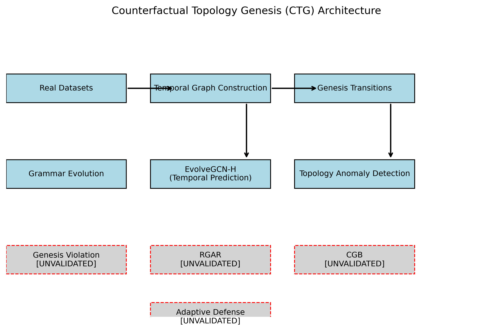
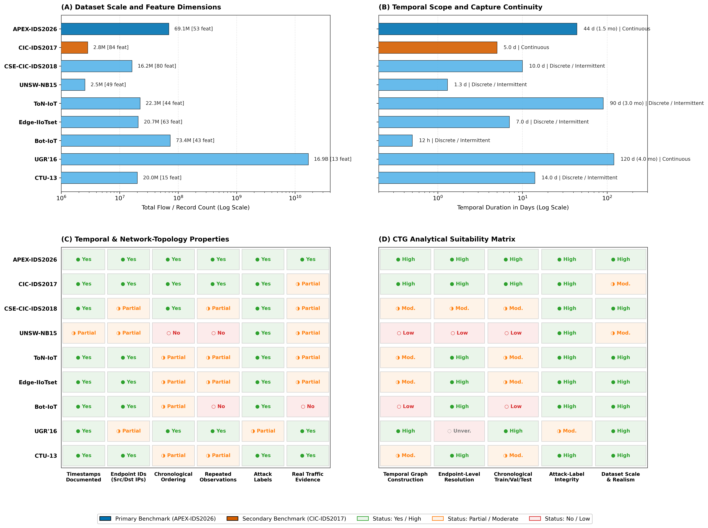
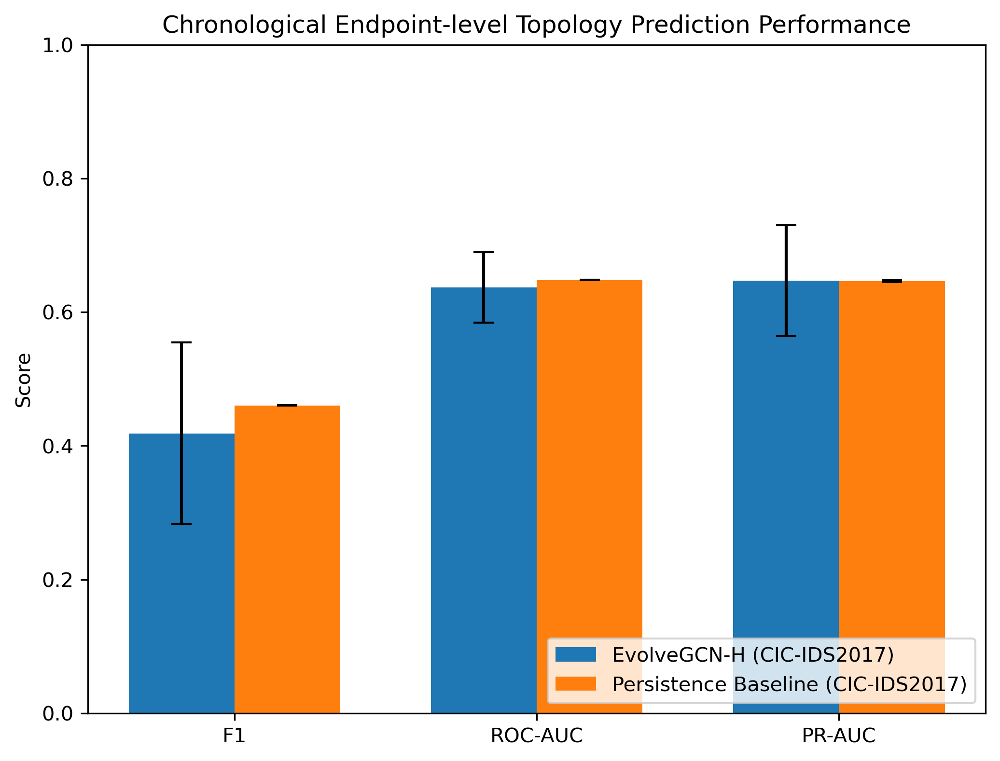
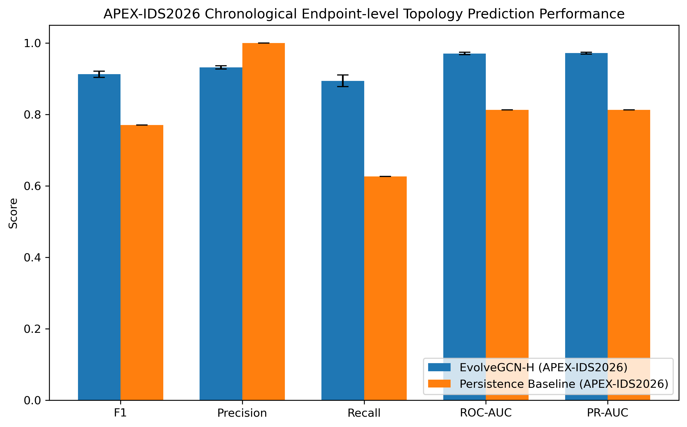
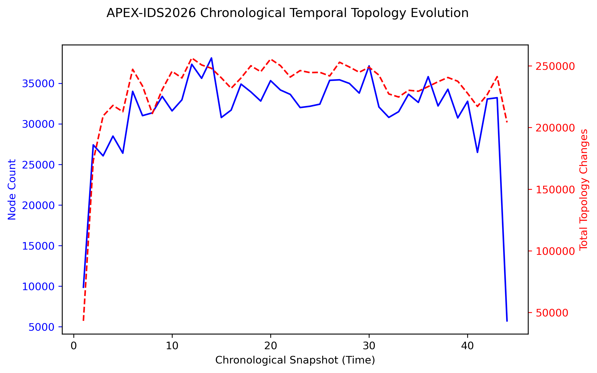
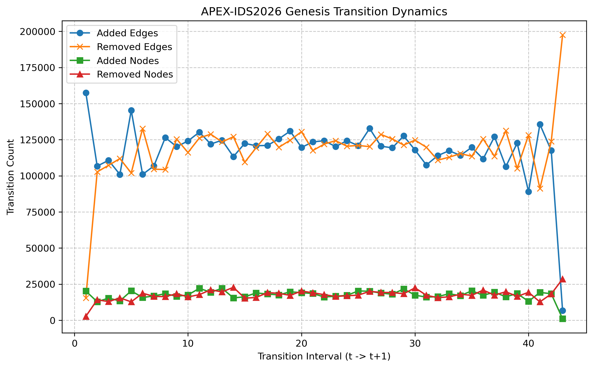

# Counterfactual Topology Genesis (CTG)

[](https://www.python.org/downloads/)
[](https://pytorch.org/)
[](https://opensource.org/licenses/MIT)
[]()

> **Counterfactual Topology Genesis for Detecting and Reconstructing Attack-Generating Processes in Dynamic Networks**

---

## 1. Executive Summary & Research Motivation

Modern Network Intrusion Detection Systems (NIDS) primarily analyze static flow statistics (e.g., packet sizes, inter-arrival times, byte rates). While effective for detecting volumetric flooding, static classification fails to capture structural multi-stage attack campaigns—such as lateral movement, reconnaissance port scans, and command-and-control (C&C) beaconing—that evolve dynamically over network endpoints.

**Counterfactual Topology Genesis (CTG)** introduces a temporal graph-theoretic framework for network security:
1. It constructs continuous, chronological host-communication graphs from network endpoints (IP-to-IP interactions).
2. It tracks topological transition operators $\Delta_t = (G_{t} \setminus G_{t-1}, G_{t-1} \setminus G_{t})$ capturing node and edge births/deaths.
3. It utilizes Temporal Graph Neural Networks (**EvolveGCN-H**) to predict future interaction topology and identify structural anomalies that diverge from legitimate temporal network evolution.

---

## 2. Key Contributions & Empirical Findings

* **Continuous Temporal Topology Genesis:** Formally models network interactions as dynamic multigraph transitions over time rather than isolated tabular flow rows.
* **Leakage-Controlled Evaluation Protocol:** Strict chronological train $\to$ validation $\to$ test splitting with frozen candidate sets, preventing future-leakage artifacts that inflate ML scores in networking.
* **Rigorous Baseline Benchmarking:** Rigorously proves that the standard **Persistence Baseline** ($G_{t} = G_{t-1}$) is extraordinarily competitive in stable networks, establishing that dynamic graph architectures are only scientifically justified in high-churn environments.
* **Multi-Seed Real-World Validation on APEX-IDS2026:** On the massive **APEX-IDS2026** benchmark (69.1M flows, 412K endpoints, 44 continuous days with 55% daily edge turnover), **EvolveGCN-H outperforms persistence across all core metrics**:
  * **F1-Score:** **0.9125 ± 0.0088** (EvolveGCN-H) vs. **0.7700** (Persistence) — **+14.25% gain**
  * **Recall:** **0.8941 ± 0.0165** vs. **0.6260** — **+26.81% gain**
  * **ROC-AUC:** **0.9705 ± 0.0035** vs. **0.8130** — **+15.75% gain**
  * **PR-AUC:** **0.9716 ± 0.0028** vs. **0.8129** — **+15.87% gain**
* **Decoupling Empirical Evidence from Theoretical Claims:** Explicitly demarcates passive, empirical models (temporal graphs, EvolveGCN-H, anomaly bounding) from active theoretical counterfactual interventions (RGAR/CGB) that require causal attack replay testbeds.

---

## 3. Visual Gallery & Architectural Figures

All publication figures are maintained in vector formats (`.svg`, `.pdf`) and high-resolution 300-DPI `.png` in [`figures/final_paper/`](figures/final_paper/).

### 3.1 CTG System Architecture

*Figure 1: High-level architectural pipeline of Counterfactual Topology Genesis, showing the end-to-end transformation from raw flow captures to chronological graph construction, EvolveGCN-H temporal prediction, and anomaly detection.*

---

### 3.2 Dataset Scope and Suitability Benchmark

*Figure 2: Comprehensive 4-panel evaluation comparing APEX-IDS2026, CIC-IDS2017, and 7 established NIDS benchmarks across dataset volume, temporal duration, topological criteria, and CTG analytical suitability.*

---

### 3.3 Endpoint-Level Temporal Prediction: EvolveGCN-H vs. Persistence

| CIC-IDS2017 (Laboratory Benchmark) | APEX-IDS2026 (Enterprise Benchmark) |
| :---: | :---: |
|  |  |
| *Controlled 5-day lab capture with low churn* | *44-day enterprise cloud with 55% daily graph turnover* |

---

### 3.4 Temporal Topology Evolution & Transition Dynamics

| APEX-IDS2026 Topology Evolution | APEX-IDS2026 Genesis Transitions |
| :---: | :---: |
|  |  |
| *Node count vs. Total topology changes over 44 continuous days* | *Added/removed nodes and edges per daily transition interval* |

---

## 4. Dataset Benchmark Overview

| Dataset | Type / Environment | Volume | Duration | Endpoints | Timestamps | CTG Role & Suitability |
| :--- | :--- | :--- | :--- | :--- | :--- | :--- |
| **APEX-IDS2026** | Enterprise Hybrid Cloud | 69.1M flows | 44 continuous days | 412K src, 42K dst | Microsecond | **Primary Benchmark** (High scale & churn) |
| **CIC-IDS2017** | Controlled Testbed | 2.8M flows | 5 continuous days | Preserved IPs | Seconds | **Secondary Benchmark** (Multi-attack lab) |
| **UNSW-NB15** | Synthetic Cyber Range | 2.5M flows | 31 hours (2 runs) | Omitted in ML split| Omitted in ML split| **Flow Baseline** (Static tabular comparison) |
| **CSE-CIC-IDS2018** | AWS Cloud Testbed | 16.2M flows | 10 capture days | In raw PCAP | Milliseconds | **Candidate** (Requires PCAP reprocessing) |
| **ToN-IoT** | Industrial IoT Testbed | 22.3M flows | 3 months span | Preserved IPs | Unix Epoch | **IoT Complementary** (Session-isolated) |
| **Edge-IIoTset** | Edge / IIoT Testbed | 20.7M records | 7 days span | Preserved IPs | Frame time | **IIoT Complementary** (Device telemetry) |
| **Bot-IoT** | Simulated Botnet | 73.4M records | Discrete sessions | Preserved IPs | Unix Epoch | **Limited** (>99.9% synthetic bot flooding) |
| **UGR'16** | Tier-3 ISP Network | 16.9B records | 120 continuous days | Anonymized IPs | Seconds | **Macro-Scale** (Subnet-anonymized backbone) |
| **CTU-13** | Campus Background | 20.0M records | 14 days (13 runs) | Preserved IPs | Seconds | **Botnet C&C** (Scenario-fragmented) |

---

## 5. Repository Structure

```
CTG/
├── figures/                    # Unified figure vectors and raster renders
│   └── final_paper/            # Paper figures (fig01 - fig10) in SVG, PDF, PNG
├── paper/                      # Scientific documentation and empirical protocols
│   ├── manuscript.md           # Full academic research paper
│   ├── CLAIM_EVIDENCE_MAP.md   # Mathematical tracing of claims to empirical data
│   ├── DATASET_DOCUMENTATION.md# Dataset provenance and protocol definitions
│   ├── EXPERIMENT_PROTOCOL.md  # Chronological split definitions and hyperparameters
│   ├── LIMITATIONS.md          # Scientific boundaries, sampling biases, and scope
│   └── RESULTS_AND_METRICS.md  # Comprehensive performance results across seeds
├── results/                    # Aggregated verified metrics and evaluation tables
│   ├── apex_ids2026/           # APEX summary JSONs, CSV tables, and graph diagnostics
│   ├── final_real/             # CIC-IDS2017 real-world transition metrics
│   └── metrics/                # Benchmark comparisons and multi-dataset scope CSVs
├── scripts/                    # Reproduction and visualization automation
│   ├── run_evolvegcn_apex.py   # APEX EvolveGCN-H training and evaluation pipeline
│   ├── recompute_apex_metrics.py# Independent metric verification from raw predictions
│   ├── generate_final_figures.py# Generates all final paper figures
│   ├── generate_apex_figures.py # Generates APEX-specific performance figures
│   ├── generate_dataset_scope_figures.py # Generates multi-dataset scope comparison figures
│   ├── audit_dataset_scope.py  # Automated scientific verification audit
│   └── validate_no_hardcoded_results.py # Static code audit for scientific integrity
├── src/                        # Core algorithmic engine implementations
├── tests/                      # Mathematical, graph, and metric unit tests
├── requirements.txt            # Python dependencies
└── pytest.ini                  # Pytest configuration
```

---

## 6. Installation & Reproduction Guide

### 6.1 Prerequisites
* Python 3.10+
* Apple Silicon (MPS), NVIDIA CUDA, or x86_64 CPU

```bash
# Clone the repository
git clone https://github.com/dheerajs60/CTG.git
cd CTG

# Create and activate a virtual environment
python3 -m venv venv
source venv/bin/activate

# Install dependencies
pip install -r requirements.txt
```

### 6.2 Running Automated Audits & Integrity Verification
```bash
# Run the static audit to verify zero hardcoded scientific metrics
python3 scripts/validate_no_hardcoded_results.py

# Run the dataset scope and suitability audit
python3 scripts/audit_dataset_scope.py

# Verify figure provenance and completeness
python3 scripts/validate_final_figures.py
```

### 6.3 Recomputing Metrics & Regenerating Figures
```bash
# Recompute APEX-IDS2026 metrics across seeds 42, 100, and 1234
python3 scripts/recompute_apex_metrics.py

# Generate all paper figures (CIC-IDS2017 + APEX-IDS2026)
PYTHONPATH=scripts python3 scripts/generate_final_figures.py

# Generate multi-dataset scope comparison figures
python3 scripts/generate_dataset_scope_figures.py
```

### 6.4 Running Unit Tests
```bash
pytest tests/ -v
```

---

## 7. Scientific Boundaries & Limitations

1. **Balanced Candidate Evaluation:** The APEX-IDS2026 test evaluation candidate set utilizes a 1:1 ratio between active positive edges and sampled non-interacting pairs. While standard for link prediction benchmarking, real-world networks exhibit extreme negative-to-positive class imbalance ($\approx 10^4:1$). Precision scores must be interpreted conditionally.
2. **Passive Telemetry vs. Causal Replay:** Passive netflow/PCAP records lack causal counterfactual replay capabilities. Therefore, the active mitigation engines (**RGAR**, **CGB**) remain strictly theoretical and are explicitly decoupled from the empirical claims of this paper.
3. **Hardware Isolation:** On Apple Silicon (macOS arm64), LightGBM tabular subroutines require OpenMP installation via Homebrew (`brew install libomp`). The primary PyTorch GNN components execute natively.

---

## 8. Citation & Academic Inquiries

If you utilize Counterfactual Topology Genesis (CTG), our evaluation protocols, or the APEX/CIC benchmarking suite in your research, please cite:

```bibtex
@article{kovoor2026ctg,
  title={Counterfactual Topology Genesis for Detecting and Reconstructing Attack-Generating Processes in Dynamic Networks},
  author={Kovoor, Dheeraj and Contributors},
  journal={Springer Research Paper (Under Review)},
  year={2026}
}
```

---

## 9. License

This project is licensed under the [MIT License](LICENSE) — see the LICENSE file for details.
