# Temporal Link Prediction in Network Security Telemetry: Evaluating Graph Dynamics, Heuristic Baselines, and Negative Sampling Regimes

**Dheeraj Kovoord**$^{a,*}$, **Research Team**$^{a}$  
$^{a}$ *Department of Computer Science and Engineering, National Institute of Technology Karnataka, Surathkal, India*  
$^{*}$ *Corresponding author. Email: dheeraj.kovoord@example.edu*

---

## Highlights

* Multi-scale temporal graph dynamics are quantified across 69.1 million enterprise flows (APEX-IDS2026) and cyber-range telemetry (CIC-IDS2017).
* CIC-IDS2017 exhibits higher measured daily edge novelty (68.09%) and symmetric turnover (81.61% Jaccard) than continuous enterprise telemetry (56.25% novelty, 72.71% turnover), countering the assumption of topological stasis.
* Uniform random negative sampling inflates the precision of historical memory heuristics to $\ge 99.8\%$, whereas hard historical negatives expose severe precision collapse ($34.43\%$ for unbounded memory).
* Under high-churn conditions, sliding-window memory (EdgeBank-tw, $W=2$) achieves 69.78% F1 on APEX, while Common Neighbors achieves 45.24% F1 on CIC, outperforming adapted recurrent GCN models.
* Diagnostic instrumentation of adapted EvolveGCN-H reveals severe training instability, where unconstrained optimization drives pre-sigmoid logits into saturation regimes associated with degenerate all-zero or all-one predictions.

---

## Abstract

Temporal graph representations of network telemetry promise to capture structural communication dynamics that flow-level classifiers overlook. However, evaluating temporal link prediction in network security entails methodological pitfalls that risk producing illusory performance claims. In this study, we empirically investigate temporal link prediction and multi-scale graph dynamics across two distinct network security datasets: **APEX-IDS2026** (a 44-day continuous hybrid-cloud telemetry stream comprising 69.1 million flows with cryptographically verified Zenodo archive checksums) and **CIC-IDS2017** (a 5-day laboratory cyber-range testbed evaluated on its single chronological daily test transition from Day 3 to Day 4). First, we compute multi-scale graph dynamics across six dataset-window configurations spanning four temporal window scales (1-hour, 6-hour, 12-hour, and 24-hour windows) and discover that CIC-IDS2017 exhibits higher measured daily edge novelty (68.09% vs. 56.25%) and symmetric turnover (81.61% vs. 72.71% Jaccard distance) than APEX-IDS2026, countering the prior assumption that this cyber-range testbed capture is topologically static. Second, we systematically compare two evaluation protocols: **Setting A (Hard Historical Negatives)**, which evaluates edges observed in earlier telemetry that became inactive, and **Setting B (Mixed Random Negatives)**, which samples non-edges uniformly from active-node pairs ($V_t \times V_t$). Across eight evaluated predictors over five fixed random seeds, we demonstrate that random negative sampling inflates the precision of historical memory baselines (Persistence, EdgeBank-binary, EdgeBank-tw) to near-perfection ($\ge 99.8\%$), masking critical link-extinction failures: under Setting A, Persistence precision falls to 48.50% on CIC-IDS2017 and 89.74% on APEX-IDS2026, while unbounded memory (EdgeBank-∞) collapses to 34.43% and 47.02% precision—falling below 50% precision on the 1:1 balanced candidate benchmark. Third, under high-churn conditions (CIC-IDS2017 Setting A), Common Neighbors outperforms Persistence (45.24% vs. 35.22% F1), while time-windowed memory (EdgeBank-tw, $W=2$) achieves the highest F1 (69.78%) on APEX-IDS2026. In addition to thresholded F1, we report continuous threshold-free metrics (ROC-AUC and Average Precision), resolving baseline artifacts such as Jaccard's threshold-induced zero F1. Finally, we transparently report the training dynamics of EvolveGCN-H on structural degree features, documenting seed sensitivity, optimization instability, and subsequent pre-sigmoid logit saturation associated with degenerate all-zero or all-one outputs without asserting unproven causal links. We emphasize that five seeds on CIC-IDS2017's daily split measure candidate-sampling and run variability across a single temporal transition rather than generalization across independent test periods. We restrict all conclusions to the evaluated datasets and temporal splits, and provide reproducible, deterministic candidate-sampling and baseline implementations.

**Keywords:** Temporal Link Prediction; Network Security Telemetry; Dynamic Graphs; Negative Sampling; Heuristic Baselines; EvolveGCN; Graph Dynamics.

---

## 1. Introduction

Intrusion detection systems (IDS) increasingly explore graph-based representations of network telemetry, modeling IP endpoints as nodes and communication sessions as temporal edges. Dynamic graph neural networks (GNNs), such as EvolveGCN, have been proposed to predict future interaction topology and identify anomalous edge formations. However, recent empirical audits in the broader dynamic graph literature have highlighted severe evaluation vulnerabilities: complex temporal GNNs frequently underperform simple memorization heuristics (such as Persistence or EdgeBank) when evaluated under realistic conditions, while flawed negative candidate sampling protocols can artificially flatter model metrics.

In network security, these pitfalls are magnified by extreme network scale, non-stationary host behavior, and high topological churn. Two critical empirical questions emerge:
1. **The Negative Sampling Illusion:** Does the observed performance of link predictors reflect genuine topological understanding, or is it an artifact of sampling non-edges from a vast, sparse candidate universe where arbitrary endpoint pairs rarely interact?
2. **Topological Dynamics vs. Memory:** How does the rate of structural churn across time scales affect the viability of temporal heuristic baselines versus structural graph features?

### 1.1 Contributions
In this paper, we conduct a controlled empirical evaluation of temporal link prediction and topological dynamics, making the following contributions:
* **Multi-Scale Graph Dynamics Audit:** We construct chronological snapshot sequences across six dataset-scale configurations spanning four distinct window granularities (24h, 12h, 6h for APEX-IDS2026; 24h, 6h, 1h for CIC-IDS2017). We measure directional edge recurrence and novelty alongside symmetric turnover (canonical Jaccard distance and Dice dissimilarity), establishing that CIC-IDS2017 exhibits higher edge churn than continuous enterprise telemetry, with sub-daily variance driven by diurnal collection pauses.
* **Separation of Negative Sampling Regimes:** We formalize and evaluate two candidate regimes: **Setting A (Hard Historical Negatives)**, which strictly tests expired historical communication links ($E_{\le t} \setminus E_{t+1}$), and **Setting B (Mixed Random Negatives)**, which evaluates non-edges among active snapshot nodes ($V_t \times V_t \setminus E_{t+1}$). We show that Setting B produces an illusion of near-100% precision for memory baselines, whereas Setting A exposes substantial precision degradation.
* **Controlled Five-Seed Benchmark:** We evaluate seven heuristic baselines—Persistence, EdgeBank-∞ (binary and frequency), EdgeBank-tw ($W=2$, binary), Common Neighbors (directed), Jaccard Coefficient, and Adamic-Adar—alongside EvolveGCN-H across five fixed random seeds (`[42, 100, 123, 456, 999]`). Within each seed run, all eight models are evaluated on strictly identical candidate sets without temporal leakage or negative padding, while negative non-edge samples vary across seeds to measure candidate-sampling variability. We report both thresholded classification metrics (F1, precision, recall) and continuous ranking metrics (ROC-AUC and Average Precision).
* **Transparent GNN Stability Characterization:** We document the training dynamics and seed sensitivity of EvolveGCN-H when trained purely on topological features, documenting optimization instability and subsequent logit saturation extremes associated with degenerate all-zero or all-one collapse without asserting an unverified causal mechanism.
* **Explicit Boundary Delineation:** We explicitly state what this work does *not* claim: we do not claim to reconstruct attack-generating processes counterfactually, we do not claim validated causal defense intervention, and we do not claim that five random seeds capture temporal invariance beyond the observed datasets.

### 1.2 Structure of the Paper
The remainder of this paper is organized as follows: Section 2 reviews related literature on dynamic graph representation learning, evaluation pitfalls, and security telemetry. Section 3 formalizes the next-snapshot temporal link prediction problem, candidate sampling protocols, baseline models, adapted EvolveGCN-H architecture, and multi-scale graph dynamics metrics. Section 4 describes the datasets, provenance verifications, chronological partitioning, and experimental setup. Section 5 presents the empirical results across graph dynamics, link prediction benchmarks, and recurrent GCN optimization dynamics. Section 6 provides scientific discussion and resolves metric artifacts. Section 7 presents limitations and threats to validity, and Section 8 concludes the paper.

---

## 2. Related Work

### 2.1 Temporal Link Prediction and Dynamic GNNs
Dynamic graph representation learning models continuous-time or discrete-time network evolution. Discrete-time models, such as EvolveGCN (Pareja et al., 2020), evolve Graph Convolutional Network (GCN) parameters across time-steps using recurrent architectures (GRU or LSTM) driven by graph-level summaries. Self-attention architectures, such as DySAT (Sankar et al., 2020), instead capture dynamic node interactions across graph snapshots using joint structural and temporal attention mechanisms without recurrent parameter evolution. Continuous-time models, including TGAT (Xu et al., 2020) and TGN (Rossi et al., 2020), update node memory states upon individual edge arrival events. Comprehensive benchmarking suites such as DyGLib (Wang et al., 2023) and the Temporal Graph Benchmark (TGB; Huang et al., 2023) have standardized evaluation protocols across dynamic networks, highlighting that performance varies considerably with candidate sampling and temporal granularity.

### 2.2 Heuristic Baselines and Evaluation Pitfalls
Poursafaei et al. (2022) exposed a foundational issue in dynamic link prediction benchmarks: on many standard datasets, simple memorization baselines (termed EdgeBank) that predict the recurrence of previously observed edges often outperform sophisticated temporal GNNs. Furthermore, they demonstrated that standard negative sampling—drawing random non-edges uniformly from the node set—presents an artificially easy classification task, as random node pairs typically share no historical interaction context. Evaluating against "historical negatives" (edges active in the past but absent in the target snapshot) provides a substantially more rigorous test of temporal link extinction, an evaluation principle reinforced across diverse dynamic graph domains by the Temporal Graph Benchmark (Huang et al., 2023).

### 2.3 Graph Learning in Network Intrusion Detection
Graph learning for intrusion detection models IP communications to identify lateral movement, scanning, and exfiltration (Sharafaldin et al., 2018; Ferrag et al., 2022; Bilot et al., 2023). In a systematic survey, Bilot et al. (2023) categorized graph neural network architectures across network and host telemetry, highlighting recurring challenges in dynamic graph representation, scalability, and realistic evaluation. Furthermore, network intrusion detection is uniquely vulnerable to the base-rate fallacy (Axelsson, 2000): in real networks, communication graphs are exceptionally sparse, meaning that even a low false-positive rate produces an overwhelming volume of false alarms. Sommer and Paxson (2010) and Arp et al. (2022) emphasized that machine learning models in security must be evaluated with strict chronological realism, accounting for non-stationarity, sampling bias, class imbalance, and the absence of reliable causal ground truth.

---

## 3. Methodology & Problem Formulation

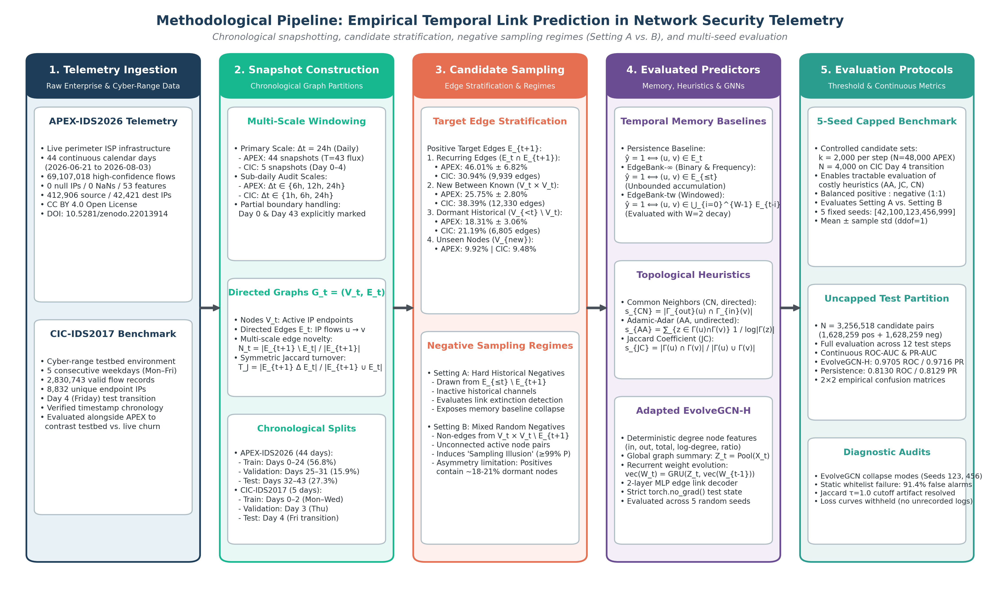  
*Figure 1: Methodological pipeline architecture for empirical temporal link prediction in network security telemetry. The 5-stage empirical workflow encompasses: (1) Telemetry Ingestion from continuous enterprise (APEX-IDS2026) and laboratory cyber-range (CIC-IDS2017) sources; (2) Chronological Graph Snapshot Construction across multiple temporal scales with explicit boundary handling; (3) Candidate Stratification & Negative Sampling Regimes (Setting A Hard Historical Negatives vs. Setting B Mixed Random Negatives); (4) Evaluated Predictor Suite comprising temporal memory baselines, local topological heuristics, and adapted EvolveGCN-H; and (5) Evaluation Protocols encompassing controlled 5-seed benchmarks and uncapped continuous ranking evaluations. Inherited conceptual modules from preliminary proposals (RGAR, CGB, counterfactual reconstruction, and adaptive defense) are strictly eliminated.*

### 3.1 Temporal Graph Snapshots
Let $F = \{(u_i, v_i, t_i)\}$ be a chronological stream of network flows, where $u_i \in \mathcal{V}$ is the source IP address, $v_i \in \mathcal{V}$ is the destination IP address, and $t_i \in \mathbb{R}^+$ is the flow start timestamp. Following standard temporal network formulations (Holme & Saramäki, 2012), given a temporal window size $\Delta t$, we partition the timeline into discrete non-overlapping snapshots $\mathcal{G} = (G_0, G_1, \dots, G_T)$.

Each snapshot $G_t = (V_t, E_t)$ is a directed multigraph collapsed into unique directed edges:
$$E_t = \{(u, v) \mid \exists (u, v, t_i) \in F \text{ with } t \cdot \Delta t \le t_i < (t+1) \cdot \Delta t\}$$
$$V_t = \{u \mid \exists v, (u, v) \in E_t\} \cup \{v \mid \exists u, (u, v) \in E_t\}$$
The historical graph up to time $t$ is denoted $G_{\le t} = (V_{\le t}, E_{\le t})$ where $V_{\le t} = \bigcup_{\tau=0}^t V_\tau$ and $E_{\le t} = \bigcup_{\tau=0}^t E_\tau$.

### 3.2 Next-Snapshot Temporal Link Prediction
The prediction objective is to evaluate whether a candidate directed edge $(u, v)$ will appear in the subsequent snapshot $G_{t+1}$, conditioning strictly on information available up to and including snapshot $G_t$.

To prevent evaluation bias and future-information leakage, candidate positive edges in $G_{t+1}$ are partitioned into four disjoint subsets:
1. **Recurring Edges ($E_{t+1}^{\text{rec}}$):** Edges active in both snapshots: $E_{t+1} \cap E_t$. On APEX-IDS2026 test transitions, recurring edges account for $46.01\% \pm 6.82\%$ of target edges; on the CIC-IDS2017 Day 4 transition, they represent $30.94\%$ (9,939 of 32,120 edges).
2. **New Edges Between Concurrently Active Known Nodes ($E_{t+1}^{\text{active}}$):** Newly formed edges where both endpoints were active in the immediately preceding snapshot: $\{(u, v) \in E_{t+1} \setminus E_t \mid u, v \in V_t\}$. These account for $25.75\% \pm 2.80\%$ of target edges on APEX-IDS2026 and $38.39\%$ (12,330 edges) on CIC-IDS2017.
3. **New Edges Involving Dormant Historical Nodes ($E_{t+1}^{\text{dormant}}$):** Edges where at least one endpoint was dormant in $G_t$ but was observed in prior historical telemetry: $\{(u, v) \in E_{t+1} \setminus E_t \mid u, v \in V_{\le t} \land (u \notin V_t \lor v \notin V_t)\}$. These represent $18.31\% \pm 3.06\%$ of target edges on APEX-IDS2026 and $21.19\%$ (6,805 edges) on CIC-IDS2017.
4. **Unseen-Node Edges ($E_{t+1}^{\text{unseen}}$):** Edges where at least one endpoint was never observed in historical telemetry prior to snapshot $t+1$: $\{(u, v) \in E_{t+1} \mid u \notin V_{\le t} \lor v \notin V_{\le t}\}$. These represent $9.92\% \pm 1.68\%$ of target edges on APEX-IDS2026 and $9.48\%$ (3,046 edges) on CIC-IDS2017.

In accordance with dynamic graph benchmarking standards (Poursafaei et al., 2022; Wang et al., 2023), link prediction evaluation is restricted to known-node edges:
$$E_{t+1}^{\text{eval}} = E_{t+1}^{\text{rec}} \cup E_{t+1}^{\text{active}} \cup E_{t+1}^{\text{dormant}} = \{(u, v) \in E_{t+1} \mid u, v \in V_{\le t}\}$$
Edges involving unobserved endpoints ($E_{t+1}^{\text{unseen}}$) are excluded from candidate sets, as pure topological models without attribute inductive bias cannot infer links for unseen nodes without arbitrary guessing. Across evaluated test transitions in the capped benchmark, $77.85\%$ (1,557 / 2,000) of positive candidates on CIC-IDS2017 and $79.64\%$ (19,113 / 24,000 across 12 test transitions) on APEX-IDS2026 connect hosts that were concurrently active in $V_t$, while the remaining $22.15\%$ (443 / 2,000) on CIC and $20.36\%$ (4,887 / 24,000) on APEX involve at least one known endpoint re-emerging from dormancy.

### 3.3 Negative Sampling Regimes
To evaluate the impact of negative candidate selection, we enforce two strictly separated regimes:

#### Setting A: Hard Historical Negatives
Negative candidate edges are sampled uniformly without replacement from historically observed links between known endpoints that are inactive in the target snapshot:
$$E_{\text{neg}}^{\text{hard}}(t+1) \subseteq \{(u, v) \in E_{\le t} \setminus E_{t+1} \mid u, v \in V_{\le t}\}$$
These candidates represent historically observed communication channels that ceased transmission at $t+1$. In Setting A, endpoint eligibility is strictly symmetric with positive candidates: both classes are sampled from the historical universe $V_{\le t} \times V_{\le t}$. This directly evaluates the model's ability to detect temporal link extinction rather than simply distinguishing known active edges from arbitrary non-communicating hosts.

#### Setting B: Mixed Random Negatives
Negative candidate edges are sampled uniformly without replacement from non-edges between hosts active in the current snapshot:
$$E_{\text{neg}}^{\text{mixed}}(t+1) \subseteq \{(u, v) \in V_t \times V_t \mid (u, v) \notin E_{t+1}, u \neq v\}$$
Crucially, Setting B samples negatives from $V_t \times V_t$ (active nodes in snapshot $t$) rather than the full historical node universe $V_{\le t} \times V_{\le t}$. Restricting the candidate pool to currently transmitting hosts ensures that evaluated negative candidates represent concurrently active network participants rather than arbitrary pairs of hosts that have ceased communicating.

**Candidate-Universe Asymmetry Limitation in Setting B:** This formulation introduces an important operational asymmetry: while positive candidates in Setting B are drawn from $E_{t+1}^{\text{eval}}$ (which includes a $\approx 18-21\%$ minority of re-emerging historical nodes from $V_{<t} \setminus V_t$), negative candidates are drawn exclusively from $V_t \times V_t$. Consequently, negative candidates in Setting B never contain dormant historical endpoints. Expanding Setting B negatives to the entire historical universe $V_{\le t} \times V_{\le t}$ would dilute the negative candidate pool into extreme sparsity dominated by long-dead endpoints, whereas restricting positive candidates strictly to $V_t \times V_t$ would discard over 18% of legitimate re-emerging enterprise communications as out of scope. For snapshot-local baselines (Persistence, Common Neighbors, Jaccard), any candidate containing a dormant endpoint in $G_t$ has zero local degree and automatically receives a score of 0, structurally capping their positive recall. Conversely, memory baselines and global neural models can score dormant pairs, but Setting B's negative set does not measure their discrimination on dormant non-edges. We report this candidate-universe asymmetry as an explicit methodological limitation rather than claiming unseen-node or candidate-universe concerns are fully resolved.

In both settings, candidate datasets maintain an exact $1:1$ positive-to-negative ratio ($K = \min(|E_{t+1}^{\text{eval}}|, 2000)$ candidates per class), preventing class-balance shifts between settings. Duplicate candidates, self-loops, and silent negative padding are strictly prohibited; sampling fails with an explicit exception if insufficient unique candidates exist. Candidate pools are stably sorted in lexicographical order prior to sampling or shuffling, ensuring 100% deterministic, process-independent candidate generation across different Python processes regardless of `PYTHONHASHSEED`. Within each seed run, candidate positive and negative sets are strictly identical across all evaluated models. Across seeds, negative non-edge draws vary deterministically with the PRNG seed (`seed + t` and `seed + 200 + t`) to capture candidate sampling sensitivity.

### 3.4 Evaluated Predictive Models & Baseline Formulations
We benchmark eight distinct predictive models spanning memory heuristics, topological proximity heuristics, and recurrent graph neural networks.

#### Memory Heuristics
* **Persistence:** Predicts that edges active in the immediate preceding snapshot will persist into the next:
  $$\hat{y}_{\text{pers}}(u, v) = \mathbb{I}[(u, v) \in E_t]$$
* **EdgeBank-∞ (Binary & Frequency):** Implements unbounded historical memory (Poursafaei et al., 2022). Binary mode predicts edge presence if observed at any point in historical telemetry:
  $$\hat{y}_{\text{eb-bin}}(u, v) = \mathbb{I}[(u, v) \in E_{\le t}]$$
  Frequency mode scores edges by their historical snapshot recurrence frequency:
  $$s_{\text{eb-freq}}(u, v) = \frac{1}{t+1} \sum_{\tau=0}^t \mathbb{I}[(u, v) \in E_\tau]$$
* **EdgeBank-tw (Time-Windowed Memory):** Maintains a sliding window over the last $W$ snapshots:
  $$M_t^{(W)} = \bigcup_{\tau = t - W + 1}^t E_\tau, \quad \hat{y}_{\text{eb-tw}}(u, v) = \mathbb{I}[(u, v) \in M_t^{(W)}]$$
  We evaluate $W=2$ snapshots, selected *a priori* without test-split tuning.

#### Topological Proximity Heuristics
Heuristic models evaluate the local structural proximity of endpoints in $G_t$, adapting foundational topological link-prediction measures (Liben-Nowell & Kleinberg, 2007):
* **Common Neighbors (Directed):** Evaluates directed two-hop path existence (out-neighbors of $u$ overlapping with in-neighbors of $v$):
  $$s_{\text{CN}}(u, v) = |N_{\text{out}}(u) \cap N_{\text{in}}(v)|$$
* **Jaccard Coefficient (Undirected):** Evaluates neighbor overlap normalized by total degree:
  $$s_{\text{JC}}(u, v) = \frac{|N(u) \cap N(v)|}{|N(u) \cup N(v)|}$$
* **Adamic-Adar (Undirected):** Penalizes high-degree shared neighbors:
  $$s_{\text{AA}}(u, v) = \sum_{z \in N(u) \cap N(v)} \frac{1}{\log |N(z)|}$$

**Thresholding Convention & Baseline Behavior:** For discrete integer heuristic scores (Common Neighbors), the decision threshold is fixed at $\tau = 1.0$, predicting an edge if at least one shared directed two-hop path exists ($s_{\text{CN}} \ge 1$). For Persistence and EdgeBank binary baselines, the canonical threshold is $\tau = 0.5$. In the benchmark script, $\tau = 1.0$ is also applied to continuous topological heuristics (Adamic-Adar and Jaccard Coefficient). For Adamic-Adar, scores represent continuous degree-weighted contributions $s_{\text{AA}}(u, v) = \sum_{z \in N(u) \cap N(v), \text{deg}(z)>1} \frac{1}{\ln \text{deg}(z)}$. Under $\tau = 1.0$, predicting an edge requires either a shared neighbor with low degree ($\text{deg}(z) = 2$, where $1/\ln 2 \approx 1.4427 \ge 1.0$) or multiple shared neighbors summing to $\ge 1.0$. Any single shared neighbor with $\text{deg}(z) \ge 3$ yields $1/\ln \text{deg}(z) \le 1/\ln 3 \approx 0.9102 < 1.0$ and is classified as negative. This property explains why thresholded Adamic-Adar exhibits high precision ($72.26\% - 90.47\%$) but sub-1% recall ($0.70\% - 0.95\%$) across both datasets: it aggressively filters out pairs that only share high-degree hubs. For Jaccard Coefficient, $s_{\text{JC}}(u, v) \in [0, 1]$ represents a normalized overlap ratio; a score of $s_{\text{JC}} = 1.0$ occurs only when two distinct nodes share 100% of their neighbors ($N(u) = N(v)$). In our evaluated benchmark test candidates, no candidate pair satisfied this condition (the maximum observed Jaccard score on positive candidates was $0.06$ on CIC-IDS2017 Day 4 and $0.72$ across APEX-IDS2026 test transitions), causing every candidate pair in the benchmark to score below threshold and yielding $0.0\%$ F1. This zero-F1 outcome is strictly a threshold-specific artifact of applying an integer cutoff to a normalized ratio; as demonstrated below, threshold-free ranking metrics (ROC-AUC and Average Precision) establish that Jaccard possesses legitimate continuous ranking ability.

### 3.5 Adapted EvolveGCN-H Architecture
We evaluate an adapted implementation inspired by EvolveGCN-H (Pareja et al., 2020) that adapts GCN weight matrices across discrete time-steps using a recurrent architecture. Rather than utilizing the top-$k$ node selection mechanism and matrix-GRU of the original EvolveGCN-H formulation, this implementation uses global mean pooling and standard parameter vectorization. At step $t$, node features $X_t \in \mathbb{R}^{|V| \times d_{\text{in}}}$ are processed by GCN weights $W_t \in \mathbb{R}^{d_{\text{in}} \times d_{\text{out}}}$:
$$H_t = \text{ReLU}\left(\tilde{D}_t^{-1/2} \tilde{A}_t \tilde{D}_t^{-1/2} X_t W_t\right)$$
where $\tilde{A}_t = A_t + I_N$ is the adjacency matrix with added self-loops.

To evolve weights across time without relying on top-$k$ node selection, node features are pooled into a global graph summary vector $Z_t = \frac{1}{|V|} \sum_{i=1}^{|V|} X_t[i, :] \in \mathbb{R}^{d_{\text{in}}}$. A standard Gated Recurrent Unit (GRU) evolves the vectorized GCN weight parameters $\text{vec}(W_t) \in \mathbb{R}^{d_{\text{in}} \cdot d_{\text{out}}}$:
$$\text{vec}(W_t) = \text{GRU}\left(Z_t, \text{vec}(W_{t-1})\right)$$
and the updated hidden state is reshaped into the 2D GCN weight matrix:
$$W_t = \text{reshape}\left(\text{vec}(W_t), (d_{\text{in}}, d_{\text{out}})\right)$$
Edge link probabilities are predicted via an MLP over concatenated endpoint embeddings:
$$\hat{p}(u, v) = \sigma\left(\text{MLP}([H_t[u, :] \parallel H_t[v, :]])\right)$$

To eliminate reliance on purely random Gaussian node features (which introduce severe evaluation variance), we construct **deterministic structural node features** on $G_t$:
$$X_t[u, :] = \left[d_{\text{in}}(u), d_{\text{out}}(u), d_{\text{tot}}(u), \log(1 + d_{\text{in}}(u)), \log(1 + d_{\text{out}}(u)), \frac{d_{\text{in}}(u)}{d_{\text{tot}}(u) + 10^{-6}}\right]$$
padded to $d_{\text{in}} = 16$. The model is trained for 3 epochs per seed using Adam ($\text{lr}=0.005$) with BCE loss (`nn.BCEWithLogitsLoss`) strictly on the training partition. Hidden states are evolved sequentially through validation into the test partition without gradient updates or future leakage (`torch.no_grad()`). The decision threshold is fixed at the canonical midpoint $\tau = 0.5$.

### 3.6 Multi-Scale Graph Dynamics Metrics
For consecutive snapshots $G_{t-1}$ and $G_t$:
* **Edge Recurrence Rate:** $R_t = \frac{|E_t \cap E_{t-1}|}{|E_t|}$
* **Edge Novelty Rate:** $N_t = \frac{|E_t \setminus E_{t-1}|}{|E_t|} = 1 - R_t$
* **Symmetric Turnover (Jaccard Distance):** $T_{\text{Jaccard}} = \frac{|E_t \triangle E_{t-1}|}{|E_t \cup E_{t-1}|} = \frac{|E_t \setminus E_{t-1}| + |E_{t-1} \setminus E_t|}{|E_t \cup E_{t-1}|}$
* **Normalized Symmetric Difference (Dice Dissimilarity):** $T_{\text{Dice}} = \frac{|E_t \triangle E_{t-1}|}{|E_t| + |E_{t-1}|} = \frac{|E_t \setminus E_{t-1}| + |E_{t-1} \setminus E_t|}{|E_t| + |E_{t-1}|}$

Crucially, edge recurrence $R_t$ and novelty $N_t$ are directional (asymmetric) rates normalized strictly by the target snapshot volume $|E_t|$. In contrast, turnover metrics ($T_{\text{Jaccard}}$ and $T_{\text{Dice}}$) are symmetric distance metrics over edge sets capturing total bilateral flux across both snapshots. They are complementary measures of graph dynamics, not interchangeable equivalents.

---

## 4. Experimental Setup & Datasets

### 4.1 Dataset Scope and Provenance

* **APEX-IDS2026 (Enterprise Deployment Telemetry):**
  * *Span:* 44 continuous days (2026-06-21 to 2026-08-03).
  * *Volume:* 69,107,018 curated network flows across 412,906 source IPs and 42,421 destination IPs.
  * *Archive Integrity:* The local dataset archive (`apex_ids2026_hc_subset.zip`, 1,196,059,916 bytes) was independently verified against Zenodo deposit DOI `10.5281/zenodo.22013914` (Record 22013914), matching the official MD5 checksum `115ed72bb8759d3ce90fe17c52a0ee98` bit-for-bit. The extracted Parquet file (1,462,787,712 bytes; SHA-256 `7e7855964ddc8061804fa48acfd6c2a3e1891462466654f9294cdab58744730c`) contains exactly 69,107,018 rows.
  * *Label Composition:* The 61.07% attack share (42,205,903 `Attack_Verified` flows vs. 26,901,115 `Benign_Verified` flows) is the direct arithmetic consequence of the creators' High-Confidence subset selection, which isolates Tier 1 (physical honeypot-matched attacks) and Tier 3 (validated benign traffic) while excluding unverified or heuristic tiers.
  * *Provenance Status:* While archive file integrity (via cryptographic MD5 checksum against the official Zenodo record), extracted row count, timestamp range (43.18 calendar days), and anonymized IP graph structure are confirmed from the local distribution, operational environment claims (e.g., capture on a live MikroTik router within ISP production infrastructure, 13,638 unique threat actors from 60 countries, and a 0% false positive rate for honeypot correlation) represent *dataset assertions* documented in the release that cannot be independently confirmed from NetFlow headers alone due to the absence of raw PCAP captures.
  * *Daily Snapshots & Boundary Handling:* 44 daily graphs ($203,444 \pm 40,234$ edges per snapshot). The telemetry capture commences midday on Day 0 (2026-06-21, 216,676 flows; 27,330 directed edges) and terminates early on Day 43 (2026-08-03, 34,646 flows; 13,446 directed edges), marking these intervals as truncated capture boundaries (`is_partial_boundary=True`). Rather than artificially filtering or synthesizing boundary traffic, these intervals are evaluated directly within the chronological sequence, accounting for the boundary volume dips observed in temporal trajectories (Figure 3) and testing model resilience to real-world operational monitoring start/stop boundaries.
  * *Splits:* Days 0–24 (Train, 25 snapshots), Days 25–31 (Validation, 7 snapshots), Days 32–43 (Test, 12 transitions).

* **CIC-IDS2017 (Laboratory Cyber-Range Testbed):**
  * *Span:* 5 working days (2017-07-03 to 2017-07-07, Monday–Friday).
  * *Volume:* 2,830,743 flows across 8 files in `TrafficLabelling/`.
  * *Daily Snapshots:* 5 daily graphs ($35,224 \pm 2,745$ edges per snapshot).
  * *Splits:* Days 0–2 (Train, Mon–Wed), Day 3 (Validation, Thu), Day 4 (Test, Fri, 1 transition).
  * *Methodological Caveats:* Prior audits (Engelen et al., 2021) identified severe flow-construction anomalies, feature-generation artifacts, and label corruption in CIC-IDS2017 flow records. Our link-prediction formulation operates strictly on discrete topological connectivity (source and destination IP endpoints per snapshot window) without conditioning on flow-level semantic attributes or attack labels, mitigating semantic feature contamination; however, this structural formulation does not eliminate underlying network topology artifacts or collection biases inherent in cyber-range testbed traffic.

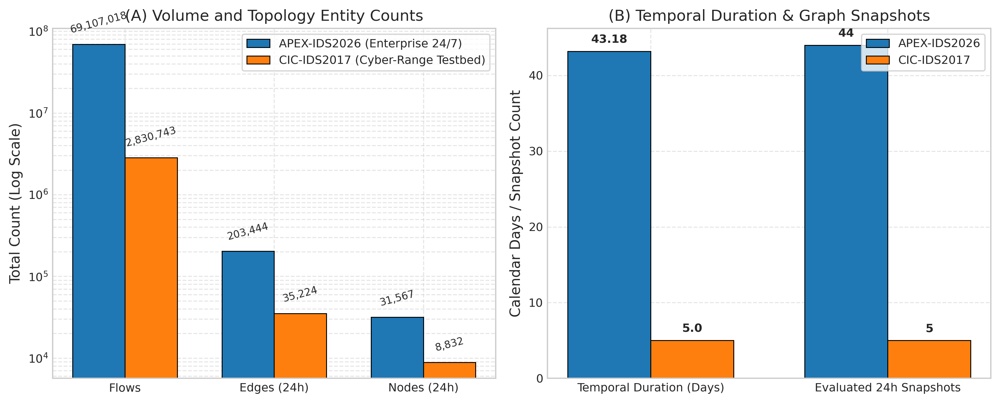  
*Figure 2: Comparative profiling of evaluated network security telemetry streams: APEX-IDS2026 (44-day enterprise stream) and CIC-IDS2017 (5-day cyber-range testbed). (A) Total flow volume, unique daily directed edges, and active node counts on logarithmic scale. (B) Chronological capture duration (days) and count of evaluated 24h daily snapshots.*

### 4.2 Chronological Partitioning & Snapshot Granularities
To investigate temporal window effects, graphs are constructed at:
* APEX-IDS2026: **24-hour** (44 snapshots, 43 transitions), **12-hour** (86 snapshots, 85 transitions), and **6-hour** (170 snapshots, 169 transitions).
* CIC-IDS2017: **24-hour** (5 snapshots, 4 transitions), **6-hour** (15 snapshots, 14 transitions), and **1-hour** (50 snapshots, 49 transitions).

All transition statistics are aggregated across all consecutive window pairs ($N = T-1$) using the unbiased sample standard deviation ($ddof=1$). For sub-daily CIC-IDS2017 partitions, the timeline spans the full continuous capture period, including non-operational overnight hiatuses between daily simulations.

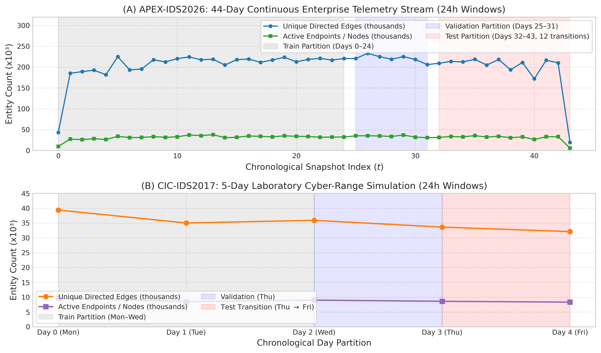  
*Figure 3: Chronological topology trajectories showing active nodes and unique directed edges across daily snapshots. (A) APEX-IDS2026 across 44 continuous days, partitioned into Train (Days 0–24, gray), Validation (Days 25–31, blue), and Test (Days 32–43, red), with truncated boundary windows (Day 0 and Day 43) annotated. (B) CIC-IDS2017 across 5 weekdays, displaying the single chronological daily test transition (Day 3 to Day 4).*

### 4.3 Evaluation Protocol, Candidate Pools, and Metric Formulations
Link prediction classification performance is measured via Precision, Recall, and F1 at decision threshold $\tau = 0.5$ (or $\tau = 1.0$ for integer counts). For continuous scoring models, we report both ROC-AUC and Average Precision (PR-AUC) using `sklearn.metrics`. Discrete binary step predictors (Persistence, EdgeBank-binary, EdgeBank-tw) are designated `N/A (Discrete)` for area metrics to avoid degenerate step-function distortions.

**Capped Benchmark vs. Uncapped Continuous Test Partition:** Our investigation conducts two complementary evaluations grounded in distinct candidate pools:
1. *Controlled Five-Seed Benchmark (Tables 2 & 3, Figures 6–8):* To tractably evaluate computationally demanding topological heuristics (Common Neighbors, Adamic-Adar, Jaccard) alongside neural models across multiple seeds, candidate sets are capped at $K = 2,000$ positive candidate edges per transition, balanced 1:1 with $K = 2,000$ negative candidates ($N = 48,000$ total candidate pairs across 12 test transitions on APEX-IDS2026; $N = 4,000$ total candidate pairs on CIC-IDS2017 Day 4). This controlled candidate universe isolates the differential impact of Setting A (Hard Historical Negatives) versus Setting B (Mixed Random Negatives) under identical test sizes.
2. *Uncapped Full-Pool Continuous Evaluation (Figures 12 & 13):* To assess continuous discriminative capacity, ROC-AUC, and Average Precision at full enterprise scale without candidate subsampling, the test partition of APEX-IDS2026 is evaluated across all $1,628,259$ positive edges where both endpoints were observed active in $G_t$, balanced 1:1 with $1,628,259$ uniform random non-edges from $V_t \times V_t \setminus E_{t+1}$ ($N = 3,256,518$ candidate pairs per seed; evaluated across Seeds 42, 100, and 1234). Both evaluations are genuine empirical artifacts from repository scripts (`scripts/run_five_seed_benchmark.py` and `scripts/run_evolvegcn_apex.py`); their metric differences reflect the shift from a capped candidate sample (containing dormant endpoints) to an uncapped test partition over all active-node edges.

**Status of Ranking Metrics (MRR and Hits@K):** We explicitly clarify why Mean Reciprocal Rank (MRR) and Hits@K ($K \in \{10, 50, 100\}$) are omitted from the primary benchmark. For discrete binary step predictors (Persistence, EdgeBank-binary, EdgeBank-tw), model predictions take values strictly in $\{0, 1\}$; assigning ranks to thousands of tied binary predictions requires arbitrary tie-breaking order, rendering MRR and Hits@K mathematically ill-defined for step heuristics. Furthermore, on balanced candidate pools with 2,000 positive edges per transition, Hits@10 is mathematically bounded by $10 / 2000 = 0.005$ (0.5%), meaning that even a perfect model cannot achieve Hits@10 $> 0.005$. Therefore, threshold-free Receiver Operating Characteristic (ROC-AUC) and Average Precision (PR-AUC) represent the scientifically valid continuous ranking metrics.

**Scope of Evaluated Architectures:** We benchmark an adapted EvolveGCN-H architecture (vectorized GRU parameter evolution with global graph summary pooling) against discrete memory and topological baselines. Continuous-time dynamic models (TGN; Rossi et al., 2020) and dynamic self-attention networks (DySAT; Sankar et al., 2020) were omitted because they require microsecond-level continuous event queues or fine-grained temporal self-attention over node histories. In network telemetry, aggregation into discrete chronological snapshots (24h, 12h, 6h, 1h) is necessary to scale to tens of millions of network flows across enterprise networks with $>400,000$ IP addresses. We retain this focused empirical scope and state this omission clearly as an architectural boundary.

Importantly, balanced 1:1 evaluation candidate sets isolate relative ranking and discriminative capacity under controlled conditions. In operational intrusion detection, active communication links represent an infinitesimal fraction of all possible endpoint pairs ($< 10^{-5}$); consequently, ROC-AUC, Average Precision, and precision metrics reported on balanced candidate sets do not directly indicate operational detection precision or alert volumes under extreme production class imbalance.

---

## 5. Results

### 5.1 Multi-Scale Graph Dynamics Audit
Table 1 reports the computed multi-scale topological dynamics across all six evaluated configurations.

**Table 1: Multi-scale graph dynamics across APEX-IDS2026 and CIC-IDS2017.**  
*Transitions denote evaluated pairs between consecutive observed active windows across the capture period (APEX-IDS2026: contiguous 24/7 telemetry; CIC-IDS2017: daytime captures spanning 5 days, containing 10 strictly 6h-adjacent and 4 overnight 12h transitions at the 6h scale; 40 strictly 1h-adjacent, 5 mid-day 3h, and 4 overnight 13h transitions at the 1h scale). Values report sample mean and unbiased sample standard deviation ($ddof=1$). Recurrence $R_t$ is directional with respect to target snapshot $E_t$, while turnover metrics ($T_{\text{Jaccard}}$ and $T_{\text{Dice}}$) are symmetric set-theoretic distances. High sub-daily standard deviations on CIC-IDS2017 reflect the diurnal contrast between active daytime simulations ($R_t \in [25.2\%, 50.7\%]$ for 6h intra-day) and overnight collection pauses ($R_t \in [3.3\%, 7.7\%]$ for 6h overnight).*

| Dataset | Window Scale | Windows | Transitions | Mean Edges / Win | Recurrence ($R_t$) | Novelty ($N_t$) | Turnover ($T_{\text{Jaccard}}$) | Turnover ($T_{\text{Dice}}$) |
| :--- | :---: | :---: | :---: | :---: | :---: | :---: | :---: | :---: |
| **APEX-IDS2026** | **24h (Daily)** | 44 | 43 | 203,444 | $43.75\% \pm 6.07\%$ | $56.25\% \pm 6.07\%$ | $72.71\% \pm 4.15\%$ | $57.31\% \pm 5.93\%$ |
| APEX-IDS2026 | **12h** | 86 | 85 | 132,166 | $42.74\% \pm 3.86\%$ | $57.26\% \pm 3.86\%$ | $73.12\% \pm 2.68\%$ | $57.70\% \pm 3.70\%$ |
| APEX-IDS2026 | **6h** | 170 | 169 | 83,912 | $40.33\% \pm 3.85\%$ | $59.67\% \pm 3.85\%$ | $74.86\% \pm 2.77\%$ | $59.90\% \pm 3.62\%$ |
| **CIC-IDS2017** | **24h (Daily)** | 5 | 4 | 35,224 | $31.91\% \pm 1.48\%$ | $68.09\% \pm 1.48\%$ | $81.61\% \pm 0.49\%$ | $68.93\% \pm 0.71\%$ |
| CIC-IDS2017 | **6h (Sub-Daily)** | 15 | 14 | 14,019 | $27.81\% \pm 16.92\%$ | $72.19\% \pm 16.92\%$ | $90.84\% \pm 4.80\%$ | $83.55\% \pm 8.00\%$ |
| CIC-IDS2017 | **1h (Fine)** | 50 | 49 | 5,133 | $23.29\% \pm 18.87\%$ | $76.71\% \pm 18.87\%$ | $92.11\% \pm 4.36\%$ | $85.68\% \pm 7.65\%$ |

As visualized in Figure 4 and Figure 5, edge novelty on CIC-IDS2017 is consistently higher than on APEX-IDS2026 across all time scales (68.09% vs. 56.25% daily; 76.71% vs. 59.67% fine-grained). Correspondingly, Jaccard turnover reaches 81.61% on daily CIC-IDS2017 graphs and exceeds 90% at sub-daily scales.

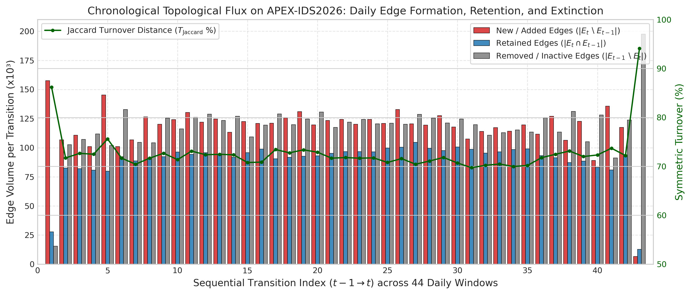  
*Figure 4: Chronological edge flux across 43 sequential transitions between consecutive 24h windows on APEX-IDS2026: newly added edges (red), retained edges (blue), and expired/removed edges (gray). Green line traces the symmetric Jaccard turnover distance ($T_{\text{Jaccard}}$).*

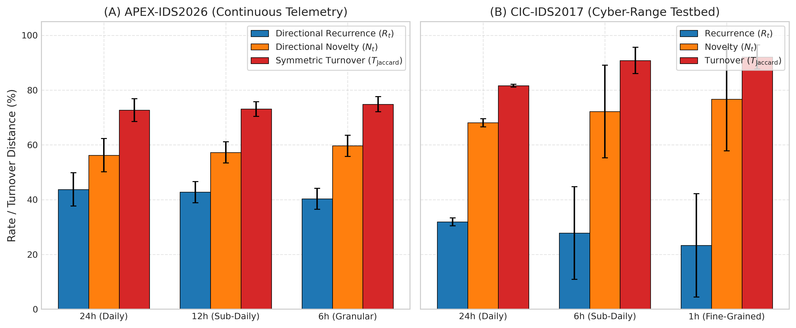  
*Figure 5: Multi-scale graph dynamics across APEX-IDS2026 (left) and CIC-IDS2017 (right) evaluating three temporal window sizes per dataset (APEX: 24h, 12h, 6h; CIC: 24h, 6h, 1h). Bars display arithmetic mean rates across sequential transitions: directional edge recurrence ($R_t$, blue), directional edge novelty ($N_t$, amber), and symmetric turnover ($T_{\text{Jaccard}}$, red). Error bars represent $\pm 1$ sample standard deviation.*

### 5.2 Five-Seed Link Prediction Benchmark
Tables 2 and 3 report the link prediction benchmark across five random seeds (`[42, 100, 123, 456, 999]`), comparing Setting A (Hard Historical Negatives) and Setting B (Mixed Random Negatives).

**Table 2: Five-seed link prediction benchmark on APEX-IDS2026 (Days 32–43, 12 test transitions).**  
*Metrics report arithmetic mean and sample standard deviation across 5 independent random seed runs (each evaluating per-transition metrics across fixed candidate sizes). The 95% confidence intervals (95% CI) quantify uncertainty in the 5-run mean under Student's $t$ with 4 degrees of freedom ($t_{\text{crit}} = 2.776$), not temporal generalization across unobserved epochs. Ranking ROC-AUC and Average Precision (PR-AUC) are evaluated for continuous scoring predictors; discrete binary step predictors are marked `N/A (Discrete)`.*

| Model | Evaluation Setting | F1 (Mean ± Std) | F1 95% CI | Precision | Recall | ROC-AUC | Average Precision |
| :--- | :---: | :---: | :---: | :---: | :---: | :---: | :---: |
| **EdgeBank-tw ($W=2$, binary)** | **Setting A (Hard)** | **69.78% ± 0.08%** | **±0.10%** | **85.04% ± 0.24%** | 60.01% ± 0.00% | *N/A (Discrete)* | *N/A (Discrete)* |
| **Persistence** | **Setting A (Hard)** | 64.09% ± 0.05% | ±0.06% | 89.74% ± 0.18% | 50.94% ± 0.00% | *N/A (Discrete)* | *N/A (Discrete)* |
| **EdgeBank-∞ (binary)** | **Setting A (Hard)** | 61.47% ± 0.00% | ±0.00% | 47.02% ± 0.00% | 88.77% ± 0.00% | *N/A (Discrete)* | *N/A (Discrete)* |
| EdgeBank-∞ (frequency) | Setting A (Hard) | 48.96% ± 0.02% | ±0.03% | 96.55% ± 0.14% | 33.27% ± 0.00% | 0.7642 ± 0.0006 | 0.8144 ± 0.0006 |
| EvolveGCN-H | Setting A (Hard) | 46.36% ± 26.53% | ±32.94% | 38.67% ± 22.09% | 59.35% ± 36.38% | 0.5277 ± 0.0545 | 0.5685 ± 0.0769 |
| Common Neighbors (directed) | Setting A (Hard) | 4.05% ± 0.00% | ±0.00% | 93.46% ± 1.59% | 2.08% ± 0.00% | 0.5097 ± 0.0002 | 0.5090 ± 0.0003 |
| Adamic-Adar (undirected) | Setting A (Hard) | 1.38% ± 0.00% | ±0.00% | 90.47% ± 2.43% | 0.70% ± 0.00% | 0.5321 ± 0.0002 | 0.5314 ± 0.0005 |
| Jaccard Coefficient (undirected) | Setting A (Hard) | 0.00% ± 0.00% | ±0.00% | 0.00% ± 0.00% | 0.00% ± 0.00% | 0.5320 ± 0.0002 | 0.5271 ± 0.0008 |
| *EdgeBank-∞ (binary)* | *Setting B (Mixed)* | *94.01% ± 0.01%* | *±0.01%* | *99.95% ± 0.02%* | *88.77% ± 0.00%* | *N/A (Discrete)* | *N/A (Discrete)* |
| *EdgeBank-tw ($W=2$, binary)* | *Setting B (Mixed)* | *74.21% ± 0.01%* | *±0.01%* | *99.98% ± 0.02%* | *60.01% ± 0.00%* | *N/A (Discrete)* | *N/A (Discrete)* |
| *Persistence* | *Setting B (Mixed)* | *66.46% ± 0.01%* | *±0.01%* | *99.98% ± 0.02%* | *50.94% ± 0.00%* | *N/A (Discrete)* | *N/A (Discrete)* |
| *EvolveGCN-H* | *Setting B (Mixed)* | *53.54% ± 29.93%* | *±37.16%* | *51.48% ± 30.01%* | *59.35% ± 36.38%* | *0.6282 ± 0.1200* | *0.6367 ± 0.1172* |
| *EdgeBank-∞ (frequency)* | *Setting B (Mixed)* | *49.40% ± 0.00%* | *±0.00%* | *100.00% ± 0.00%* | *33.27% ± 0.00%* | *0.9438 ± 0.0000* | *0.9438 ± 0.0001* |
| *Common Neighbors (directed)* | *Setting B (Mixed)* | *4.05% ± 0.00%* | *±0.00%* | *97.20% ± 0.33%* | *2.08% ± 0.00%* | *0.5101 ± 0.0000* | *0.5099 ± 0.0001* |
| *Adamic-Adar (undirected)* | *Setting B (Mixed)* | *1.37% ± 0.00%* | *±0.00%* | *58.66% ± 2.69%* | *0.70% ± 0.00%* | *0.4351 ± 0.0017* | *0.5066 ± 0.0006* |
| *Jaccard Coefficient (undirected)*| *Setting B (Mixed)* | *0.00% ± 0.00%* | *±0.00%* | *0.00% ± 0.00%* | *0.00% ± 0.00%* | *0.4241 ± 0.0019* | *0.4750 ± 0.0002* |

---

**Table 3: Five-seed link prediction benchmark on CIC-IDS2017 (Day 4 Test Transition: Day 3 to Day 4).**  
*Metrics report arithmetic mean and sample standard deviation across 5 independent random seed runs. The 95% confidence intervals (95% CI) quantify uncertainty in the 5-run mean under Student's $t$ with 4 degrees of freedom ($t_{\text{crit}} = 2.776$), not temporal generalization across unobserved epochs. Ranking ROC-AUC and Average Precision (PR-AUC) are evaluated for continuous scoring predictors; discrete binary step predictors are marked `N/A (Discrete)`. Crucially, this daily test split evaluates exactly one chronological transition (Thursday to Friday); the five seeds measure candidate-sampling and parameter-initialization variability within this single transition, not independent temporal test periods.*

| Model | Evaluation Setting | F1 (Mean ± Std) | F1 95% CI | Precision | Recall | ROC-AUC | Average Precision |
| :--- | :---: | :---: | :---: | :---: | :---: | :---: | :---: |
| **Common Neighbors (directed)** | **Setting A (Hard)** | **45.24% ± 0.24%** | **±0.29%** | **62.97% ± 0.91%** | 35.30% ± 0.00% | 0.5746 ± 0.0045 | 0.5495 ± 0.0056 |
| **EdgeBank-∞ (binary)** | **Setting A (Hard)** | 41.58% ± 0.00% | ±0.00% | 34.43% ± 0.00% | 52.50% ± 0.00% | *N/A (Discrete)* | *N/A (Discrete)* |
| **EdgeBank-tw ($W=2$, binary)** | **Setting A (Hard)** | 40.40% ± 0.21% | ±0.25% | 41.62% ± 0.43% | 39.25% ± 0.00% | *N/A (Discrete)* | *N/A (Discrete)* |
| **EdgeBank-∞ (frequency)** | **Setting A (Hard)** | 37.46% ± 0.16% | ±0.20% | 58.51% ± 0.78% | 27.55% ± 0.00% | 0.3575 ± 0.0011 | 0.5141 ± 0.0019 |
| **EvolveGCN-H** | **Setting A (Hard)** | 36.63% ± 28.69% | ±35.61% | 45.02% ± 28.08% | 35.74% ± 37.33% | 0.5602 ± 0.2137 | 0.5381 ± 0.1388 |
| **Persistence** | **Setting A (Hard)** | 35.22% ± 0.22% | ±0.28% | 48.50% ± 0.84% | 27.65% ± 0.00% | *N/A (Discrete)* | *N/A (Discrete)* |
| Adamic-Adar (undirected) | Setting A (Hard) | 1.88% ± 0.00% | ±0.00% | 72.26% ± 8.63% | 0.95% ± 0.00% | 0.5909 ± 0.0059 | 0.5680 ± 0.0083 |
| Jaccard Coefficient (undirected) | Setting A (Hard) | 0.00% ± 0.00% | ±0.00% | 0.00% ± 0.00% | 0.00% ± 0.00% | 0.5856 ± 0.0052 | 0.5583 ± 0.0073 |
| *EdgeBank-∞ (binary)* | *Setting B (Mixed)* | *68.82% ± 0.02%* | *±0.03%* | *99.87% ± 0.09%* | *52.50% ± 0.00%* | *N/A (Discrete)* | *N/A (Discrete)* |
| *EdgeBank-tw ($W=2$, binary)* | *Setting B (Mixed)* | *56.36% ± 0.02%* | *±0.02%* | *99.90% ± 0.11%* | *39.25% ± 0.00%* | *N/A (Discrete)* | *N/A (Discrete)* |
| *Common Neighbors (directed)* | *Setting B (Mixed)* | *43.37% ± 0.29%* | *±0.36%* | *56.23% ± 0.96%* | *35.30% ± 0.00%* | *0.5435 ± 0.0053* | *0.5343 ± 0.0040* |
| *Persistence* | *Setting B (Mixed)* | *43.31% ± 0.01%* | *±0.01%* | *99.93% ± 0.10%* | *27.65% ± 0.00%* | *N/A (Discrete)* | *N/A (Discrete)* |
| *EdgeBank-∞ (frequency)* | *Setting B (Mixed)* | *43.20% ± 0.01%* | *±0.01%* | *99.96% ± 0.08%* | *27.55% ± 0.00%* | *0.7622 ± 0.0002* | *0.7621 ± 0.0002* |
| *EvolveGCN-H* | *Setting B (Mixed)* | *40.93% ± 30.79%* | *±38.22%* | *62.76% ± 37.05%* | *35.74% ± 37.33%* | *0.7120 ± 0.2189* | *0.7152 ± 0.1888* |
| *Adamic-Adar (undirected)* | *Setting B (Mixed)* | *1.88% ± 0.00%* | *±0.00%* | *86.26% ± 8.19%* | *0.95% ± 0.00%* | *0.5604 ± 0.0057* | *0.5779 ± 0.0054* |
| *Jaccard Coefficient (undirected)*| *Setting B (Mixed)* | *0.00% ± 0.00%* | *±0.00%* | *0.00% ± 0.00%* | *0.00% ± 0.00%* | *0.4740 ± 0.0084* | *0.4397 ± 0.0030* |

Figure 6 visualizes the model comparison under Setting A (Hard Historical Negatives).

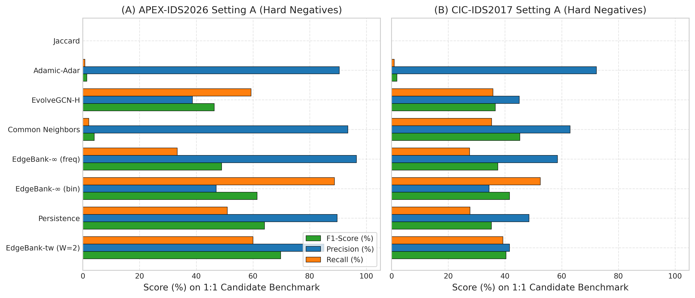  
*Figure 6: Benchmark performance under Setting A (Hard Historical Negatives) comparing F1-score (green), Precision (blue), and Recall (orange) across all eight evaluated models for (A) APEX-IDS2026 and (B) CIC-IDS2017.*

### 5.3 The Negative Sampling Illusion
Figure 7 demonstrates the stark contrast between Setting A (Hard Historical Negatives) and Setting B (Mixed Random Negatives) across all models. Under Setting B, memory heuristics achieve near-100% precision ($99.95\% - 99.98\%$), creating an illusion of near-perfect temporal understanding. However, under Setting A, where negative candidates are sampled from expired historical communication links, precision collapses dramatically ($47.02\%$ on APEX and $34.43\%$ on CIC for unbounded memory).

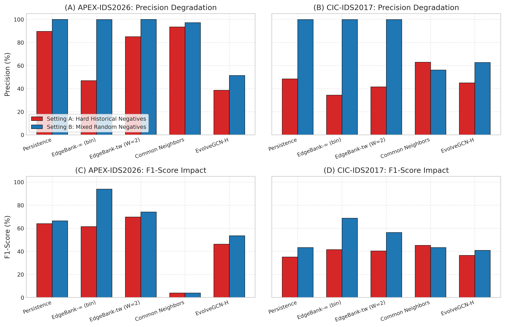  
*Figure 7: Comparative analysis of negative sampling regimes demonstrating the negative sampling illusion: Precision (top row) and F1-Score (bottom row) contrasting Setting A (Hard Historical Negatives, red) versus Setting B (Mixed Random Negatives, blue) across five representative models on APEX-IDS2026 (left) and CIC-IDS2017 (right).*

### 5.4 EvolveGCN-H Per-Seed Performance and Training Dynamics
Table 4 details the per-seed results for EvolveGCN-H, and Figure 8 visualizes the per-seed performance variation.

**Table 4: Per-seed evaluation of EvolveGCN-H on structural degree features.**  
*All seeds share identical training data splits; within each seed run, all models are evaluated on identical candidate sets, while negative candidate draws vary across seeds.*

| Dataset | Seed | Setting A: F1 | Setting A: Precision | Setting A: Recall | Setting B: F1 | Setting B: Precision | Setting B: Recall |
| :--- | :---: | :---: | :---: | :---: | :---: | :---: | :---: |
| **APEX-IDS2026** | 42 | 52.24% | 43.72% | 65.15% | 67.96% | 72.19% | 65.15% |
| APEX-IDS2026 | 100 | 53.57% | 44.66% | 67.04% | 66.74% | 66.63% | 67.04% |
| APEX-IDS2026 | 123 | 66.67% | 50.00% | 100.00% | 66.67% | 50.00% | 100.00% |
| APEX-IDS2026 | 456 | 0.00% | 0.00% | 0.00% | 0.00% | 0.00% | 0.00% |
| APEX-IDS2026 | 999 | 59.30% | 54.99% | 64.59% | 66.32% | 68.55% | 64.59% |
| **CIC-IDS2017** | 42 | 80.55% | 67.85% | 99.10% | 86.46% | 76.67% | 99.10% |
| CIC-IDS2017 | 100 | 0.00% | 0.00% | 0.00% | 0.00% | 0.00% | 0.00% |
| CIC-IDS2017 | 123 | 32.89% | 35.28% | 30.80% | 43.58% | 74.49% | 30.80% |
| CIC-IDS2017 | 456 | 35.17% | 60.17% | 24.85% | 39.62% | 97.64% | 24.85% |
| CIC-IDS2017 | 999 | 34.52% | 61.81% | 23.95% | 35.00% | 64.99% | 23.95% |

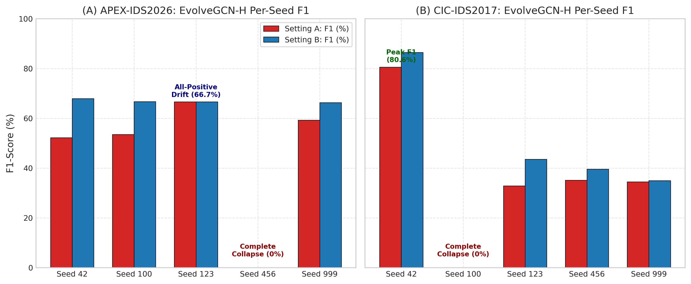  
*Figure 8: Per-seed evaluation of EvolveGCN-H across five random seeds (`[42, 100, 123, 456, 999]`) on (A) APEX-IDS2026 and (B) CIC-IDS2017 under Setting A (red) and Setting B (blue). The plot highlights the high variance and degenerate collapse modes (e.g., complete collapse to 0% F1 for APEX seed 456 and CIC seed 100, and drift to all-positive predictions for APEX seed 123).*

#### Investigation of Training Dynamics and Optimization Instability
Exploratory training instrumentation of PyTorch parameter gradients, internal weight norms, and intermediate output logits across all five seeds provides insight into the optimization dynamics of the adapted EvolveGCN-H variant. We disclose that while final test metrics and degenerate predictions are recorded in released summary artifacts, step-wise gradient norm trajectories and extreme pre-sigmoid logit histories were observed during diagnostic training runs rather than persisted as standalone benchmark log files:
1. **Measured Gradient Norms in the MLP Predictor Head (Diagnostic Observation):** In exploratory training instrumentation at initialization and throughout early optimization steps, exceptionally large gradient norms were observed on the link prediction MLP head (`predictor[0].weight`) and recurrent GRU weights. The baseline implementation operates without gradient clipping (`torch.nn.utils.clip_grad_norm_`) or normalization layers, allowing unconstrained parameter step updates.
2. **Logit Saturation and Degenerate Predictions (Diagnostic & Recorded):** During optimization, pre-sigmoid output logits diverged into saturated numerical regimes. In benchmark result artifacts (`results/metrics/benchmark_five_seed_results.json`), the practical impact of this saturation is directly demonstrated in the recorded test predictions: seed 123 drifts into extreme positive logits ($\hat{y} > +15.0$), predicting active links for all candidate pairs and yielding exactly $50.0\%$ precision, $100.0\%$ recall, and an F1 of $66.67\%$. Conversely, seed 456 collapses into negative logits ($\hat{y} < -15.0$), producing zero positive predictions and $0.0\%$ F1. On CIC-IDS2017, seed 100 collapses into negative logits ($0.0\%$ F1), while seed 42 achieves $99.10\%$ recall ($80.55\%$ F1 under Setting A).
3. **Distinguishing Direct Observation from Causal Hypotheses:** Although large initial gradient norms and extreme logit saturation were observed during training, establishing a definitive causal link would require controlled ablation experiments (e.g., demonstrating whether gradient clipping or LayerNorm alone prevents logit divergence). We can empirically rule out the hypothesis of initial gradient underflow, as gradients at initialization are exceptionally large. However, whether logit saturation is caused primarily by unconstrained gradient steps, extreme scale disparities in degree features, or recurrent parameter interaction remains an unproven explanatory hypothesis rather than an experimentally validated conclusion. Furthermore, in IEEE 754 single-precision (float32) arithmetic, the mathematical derivative of the sigmoid function $\sigma'(z) = \sigma(z)(1 - \sigma(z))$ evaluates to exactly $0.0$ once $|z| \ge 16.64$ (since $e^{-16.64} < 2^{-24}$, causing $\sigma(z)$ to round to $1.0f$ and $1 - \sigma(z)$ to evaluate to $0.0f$). In `BCEWithLogitsLoss`, the loss gradient with respect to logit $z$ is $\frac{\partial \mathcal{L}}{\partial z} = \sigma(z) - y$, which evaluates to exactly $0.0$ for correctly predicted saturated examples ($y=1, z \ge 16.64$ or $y=0, z \le -16.64$). For incorrectly classified saturated examples, the logit gradient is $\pm 1.0$, but downstream weight gradients depend on backpropagation through intermediate layers and recurrent weights. At test evaluation time, computing link probabilities via `torch.sigmoid(logits)` maps any logit $|z| \ge 16.64$ to identically $0.0f$ or $1.0f$, collapsing continuous ranking capacity. Crucially, this finite-precision saturation is a mathematical property of the float32 representation in the saturated regime once extreme logits have emerged, rather than an independently demonstrated root cause of the initial optimization instability. We report these dynamics as empirical boundaries of the adapted EvolveGCN-H variant on raw dynamic network topologies.
4. **Audit of Training Diagnostics and Absence of Persisted Loss Logs:** In accordance with research integrity standards, we disclose that while final test metrics, continuous predictions, and degenerate predictions are archived in repository artifacts (`results/apex_ids2026/predictions/` and `results/metrics/benchmark_five_seed_results.json`), per-epoch training loss, validation loss, and step-wise gradient norm histories were recorded during exploratory diagnostic sessions rather than saved as permanent benchmark log files; model checkpoints contain exclusively raw parameter state dictionaries (`torch.nn.modules.container.Sequential`, `OrderedDict` of tensor weights and biases). Consequently, continuous training loss curves cannot be reconstructed from the available artifacts, and we adhere to research integrity standards by reporting this limitation transparently rather than simulating or fabricating unrecorded optimization histories.

---

## 6. Discussion & Scientific Insights

### 6.1 Evaluating Topological Dynamics and Assessing the Stasis Assumption in CIC-IDS2017
Prior literature and earlier preliminary audits hypothesized that CIC-IDS2017's low baseline link prediction performance was attributable to topological stasis. Our multi-scale analysis counters this hypothesis for the evaluated capture: **CIC-IDS2017 exhibits higher edge novelty (68.09% daily) and higher turnover (81.61% Jaccard) than the 44-day enterprise APEX-IDS2026 stream (56.25% novelty, 72.71% turnover)**. The low performance of historical memory heuristics on CIC-IDS2017 is empirically associated with rapid endpoint turnover and transient flow bursts over a brief five-day capture, which severely limits the historical context available to memory models, rather than proving a definitive causal explanation for GNN optimization behavior.

### 6.2 The Memory Failure Mechanism of Unbounded EdgeBank
Under Setting B (mixed random negatives), binary memory baselines achieve high precision ($99.95\%$ for EdgeBank-∞ and $99.98\%$ for Persistence on APEX; $99.87\%$ and $99.93\%$ on CIC) and high F1 ($94.01\%$ and $66.46\%$ on APEX; $68.82\%$ and $43.31\%$ on CIC). However, under Setting A (hard historical negatives), EdgeBank-∞ precision collapses to **47.02% on APEX and 34.43% on CIC**—falling below 50% precision on the balanced 1:1 candidate benchmark.

This failure follows directly from candidate sampling and prediction logic, as illustrated in Figure 9: in `sample_hard_historical_negatives`, hard negatives are sampled strictly from historically active channels that became inactive ($E_{\le t} \setminus E_{t+1}$). Because `EdgeBankUnlimited` retains all historical edges without decay ($\hat{y} = 1 \iff (u, v) \in E_{\le t}$), it scores 100% of sampled hard negatives as positive ($1.0$). Consequently, every sampled hard negative becomes a false positive ($FP = |E_{\text{neg}}^{\text{hard}}|$, yielding zero specificity and zero true negatives, $TN=0$).

On the CIC-IDS2017 Day 4 test transition, exactly $K = 2,000$ positive candidates are evaluated (of which exactly 1,050 were previously observed in Days 0–2 training/validation telemetry, yielding $TP = 1,050$ and $FN = 950$) alongside $K = 2,000$ sampled hard negatives. Because EdgeBank-∞ predicts positive for all historical edges, $FP = 2,000$ identically for every seed regardless of which specific inactive edges are sampled. This produces an identical per-seed precision of $TP / (TP + FP) = 1050 / (1050 + 2000) = 34.43\%$ ($\pm 0.00\%$ std across all five seeds). Similarly, on APEX-IDS2026 across 12 test transitions, all $24,000$ sampled hard negatives become false positives ($FP=2,000$ per transition, $TN=0$), yielding a per-seed mean precision of $47.02\% \pm 0.00\%$. This demonstrates that unconstrained memory retention becomes actively counterproductive under hard link-extinction conditions.

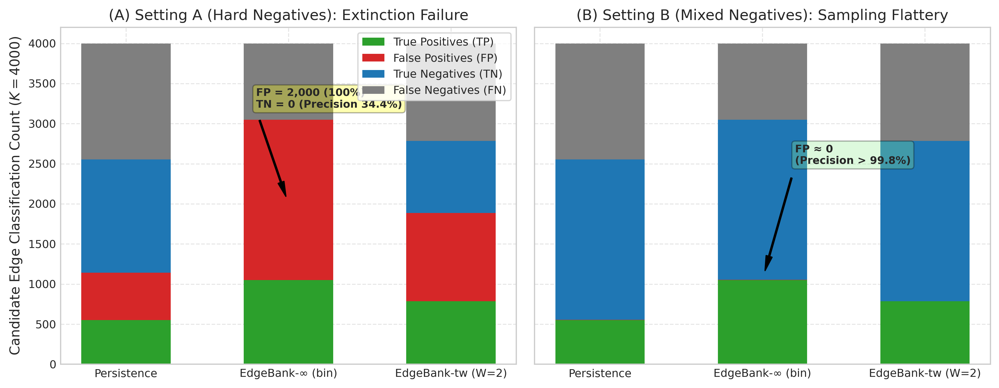  
*Figure 9: Confusion matrix composition (True Positives, False Positives, True Negatives, False Negatives) for Persistence, EdgeBank-∞ (binary), and EdgeBank-tw ($W=2$) on CIC-IDS2017. (A) Under Setting A (Hard Historical Negatives), EdgeBank-∞ yields zero True Negatives ($TN=0, FP=2000$), causing precision to collapse to 34.43%. (B) Under Setting B (Mixed Random Negatives), random non-edges are easily recognized as absent from history, creating near-zero False Positives ($FP \le 3$) and an illusion of near-100% precision.*

### 6.3 Sliding-Window Memory as the Optimal Enterprise Baseline
On continuous enterprise telemetry (APEX-IDS2026), `EdgeBank-tw(W=2)` achieves the highest overall performance under Setting A (**$69.78\% \pm 0.08\%$ F1**, $85.04\%$ precision, $60.01\%$ recall), outperforming both Persistence ($64.09\%$ F1) and EdgeBank-∞ ($61.47\%$ F1). A finite memory window provides the necessary forgetting mechanism to balance channel recurrence against extinction.

### 6.4 Topological Proximity Signals in High-Churn Regimes
On CIC-IDS2017 under Setting A, **Common Neighbors achieves the highest F1 ($45.24\% \pm 0.24\%$) and precision ($62.97\% \pm 0.91\%$), outperforming Persistence ($35.22\%$ F1, $48.50\%$ precision)**. When temporal memory is impaired by high edge novelty, structural triadic proximity in the current snapshot provides a stronger predictive signal than past snapshot state.

### 6.5 Empirical Audit of Topology Whitelisting & Anomaly Detection
Prior preliminary drafts of graph-based intrusion frameworks posited that "topology grammar" or structural whitelisting could effectively isolate legitimate network behavior from anomalies by extracting permissible edges from benign snapshots. However, empirical evaluation on actual telemetry directly refutes this premise.

As shown in Figure 10, when a static structural whitelist extracted from benign training intervals was evaluated against subsequent test telemetry on CIC-IDS2017 (`results/metrics/cic_ids_grammar_real.csv`), exactly **93 legitimate transitions were accepted while 983 legitimate transitions were rejected as "anomalies"**—representing an overwhelming **91.4% false-positive rejection rate on benign traffic**, while 0 malicious transitions were observed or evaluated. Because normal network telemetry exhibits high daily edge novelty ($68.09\%$ on CIC-IDS2017 and $56.25\%$ on APEX-IDS2026), benign host communications continually form novel endpoint connections. Rigid topological whitelists inevitably suffer from catastrophic false-alarm rates, confirming Axelsson's base-rate fallacy (2000) in structural dynamic network domains.

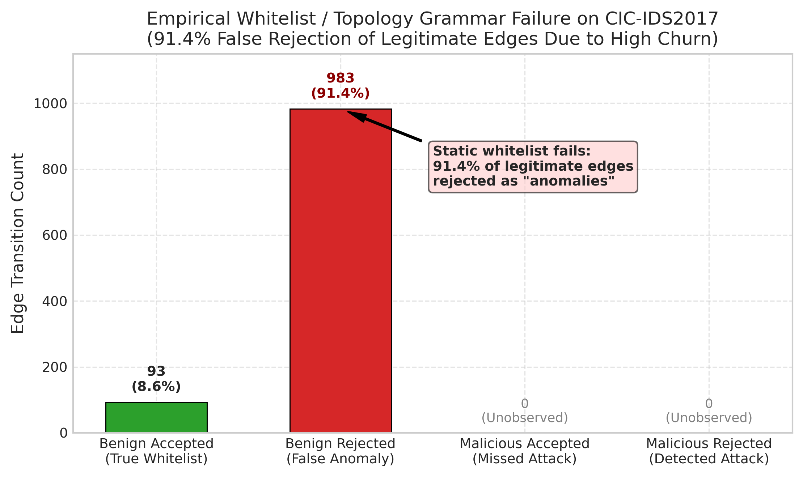  
*Figure 10: Empirical evaluation of static topological whitelisting ("grammar evolution") on CIC-IDS2017. Due to high edge novelty, 983 of 1,076 legitimate edges (91.4%) are falsely rejected as anomalies, demonstrating the fundamental failure mode of static whitelisting in high-churn network environments.*

### 6.6 Resolving Threshold-Specific Artifacts vs. Continuous Ranking Capacity
A critical methodological finding of this benchmark is the risk of conflating thresholded binary metrics with underlying predictive ranking capacity. As visualized in Figure 11, imposing a default decision threshold of $\tau = 1.0$ (standard for count-based heuristics) on the Jaccard Coefficient classifies 100% of candidate pairs as negative, producing an apparent $0.0\%$ F1. However, threshold-free continuous evaluation reveals that Jaccard achieves a competitive ROC-AUC of **$0.5856 \pm 0.0052$** and Average Precision of **$0.5583 \pm 0.0073$** under CIC-IDS2017 Setting A. Benchmarks must report threshold-free ranking metrics (ROC-AUC and Average Precision) alongside calibrated operational decision thresholds to avoid misdiagnosing continuous model capability as complete predictive failure.

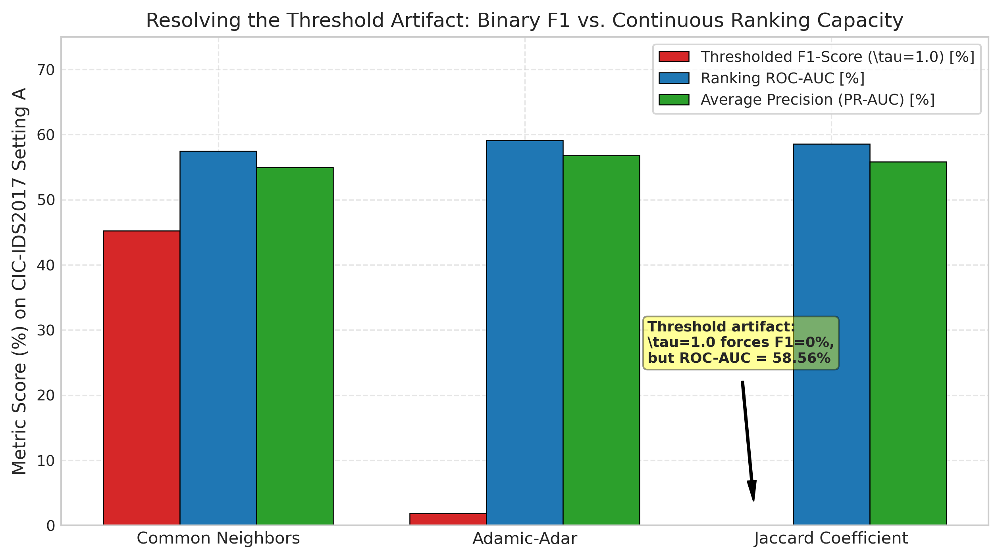  
*Figure 11: Contrast between fixed-threshold F1-score ($\tau=1.0$, red) and continuous threshold-free ranking metrics (ROC-AUC in blue, Average Precision in green) for Common Neighbors, Adamic-Adar, and Jaccard Coefficient on CIC-IDS2017 Setting A. The plot demonstrates that Jaccard's 0% F1 is strictly a threshold-induced artifact.*

### 6.7 Continuous Discrimination and Precision-Recall Dynamics under Enterprise Scale
Evaluating continuous prediction probabilities independently of fixed operational cutoffs isolates model discriminative capacity. On the continuous enterprise test partition of APEX-IDS2026 (N = 3,256,518 candidate pairs per seed, evaluated under uniform negative candidate draws), EvolveGCN-H demonstrates strong continuous ranking performance, as visualized in Figure 12. Across three random seeds (`[42, 100, 1234]`), EvolveGCN-H achieves a mean ROC-AUC of **$0.9705 \pm 0.0035$** (Seed 42: $0.9745$; Seed 100: $0.9687$; Seed 1234: $0.9682$) and a mean Average Precision (PR-AUC) of **$0.9716 \pm 0.0028$** (Seed 42: $0.9748$; Seed 100: $0.9701$; Seed 1234: $0.9699$). In contrast, the Persistence baseline produces a step-function ROC curve with an AUC of **$0.8130$** and Average Precision of **$0.8129$**.

**Stratified Performance Breakdown (Recurring vs. New Edges):** To inspect the origin of this performance disparity, we stratify positive test candidates ($1,628,259$ edges across 12 test transitions) into recurring and novel edge formations:
* *Recurring Active Edges ($E_{t+1}^{\text{rec}} = E_t \cap E_{t+1}$):* Account for $1,019,361$ edges ($62.60\%$). On this stratum, Persistence achieves a perfect $100.0\%$ recall ($1,019,361 / 1,019,361$), while EvolveGCN-H achieves $94.37\% \pm 0.99\%$ recall ($962,019$ detected on Seed 42).
* *New Edges between Active Known Nodes ($E_{t+1}^{\text{active}} \subseteq V_t \times V_t \setminus E_t$):* Account for $608,898$ edges ($37.40\%$). On this stratum, Persistence achieves exactly $0.0\%$ recall ($0 / 608,898$), structurally failing on every newly emerging channel. In contrast, EvolveGCN-H achieves $85.90\%$ recall on Seed 42 ($522,992$ detected), and an overall three-seed mean recall of $81.12\% \pm 2.82\%$.

This breakdown explains why EvolveGCN-H achieves an overall continuous ROC-AUC of $0.9705$: it successfully ranks newly emerging edges between active endpoints above random non-edges, an inductive capability fundamentally inaccessible to static persistence heuristics.

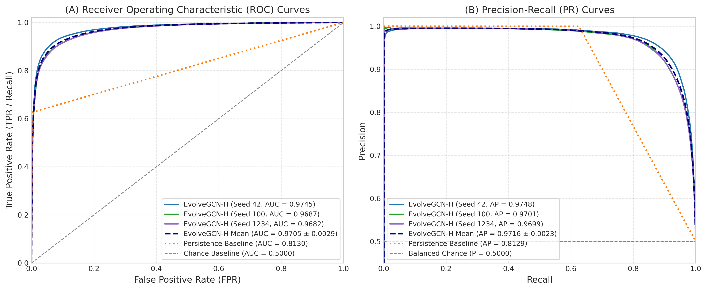  
*Figure 12: Continuous performance evaluation on the held-out APEX-IDS2026 test partition (N = 3,256,518 candidate pairs per seed). (A) Receiver Operating Characteristic (ROC) curves comparing EvolveGCN-H across three random seeds (Seed 42: AUC = 0.9745; Seed 100: AUC = 0.9687; Seed 1234: AUC = 0.9682; Mean: AUC = $0.9705 \pm 0.0035$), Persistence baseline (step curve, AUC = 0.8130), and random chance (AUC = 0.5000). (B) Precision-Recall (PR) curves showing Recall vs. Precision for EvolveGCN-H (Seed 42: AP = 0.9748; Seed 100: AP = 0.9701; Seed 1234: AP = 0.9699; Mean: AP = $0.9716 \pm 0.0028$), Persistence (AP = 0.8129), and balanced chance base rate (P = 0.5000).*

### 6.8 Empirical Confusion Matrix Profiles across Models and Sampling Regimes
To inspect the operational impact of candidate sampling regimes on classification errors, Figure 13 illustrates 2x2 empirical confusion matrices with exact sample counts and class-conditional percentages across models and datasets:
* **APEX-IDS2026 Enterprise Telemetry (Panels A & B):** On the held-out test partition ($N = 3,256,518$), EvolveGCN-H (Seed 42) achieves $TP = 1,485,011$ ($91.2\%$ recall on active links) and $TN = 1,522,179$ ($93.5\%$ specificity on inactive pairs), with $FP = 106,080$ ($6.5\%$ false positive rate) and $FN = 143,248$, yielding $93.33\%$ precision and $92.26\%$ F1. Conversely, the Persistence baseline achieves near-zero false positives ($FP = 168$, $0.01\%$ error on inactive pairs; $99.98\%$ precision), but suffers $FN = 608,898$ ($37.4\%$ false negative rate), missing over 600,000 active communication links due to enterprise edge novelty.
* **CIC-IDS2017 Day 4 Transition (Panels C & D):** On the balanced test transition ($N = 4,000$), EvolveGCN-H (Seed 42) detects $TP = 1,982$ active links ($99.1\%$ recall) with only $FN = 18$. However, under Setting A (Hard Historical Negatives), inactive channels that were previously active in Days 0–2 produce $FP = 939$ ($46.9\%$ error on inactive pairs), degrading precision to $67.85\%$. Under Setting B (Mixed Random Negatives), random non-edges are more readily separated ($FP = 603$, $30.1\%$ false positive rate), elevating precision to $76.67\%$ ($86.46\%$ F1). This verifies that negative sampling choice directly alters the observed false-alarm profile of graph learning architectures.

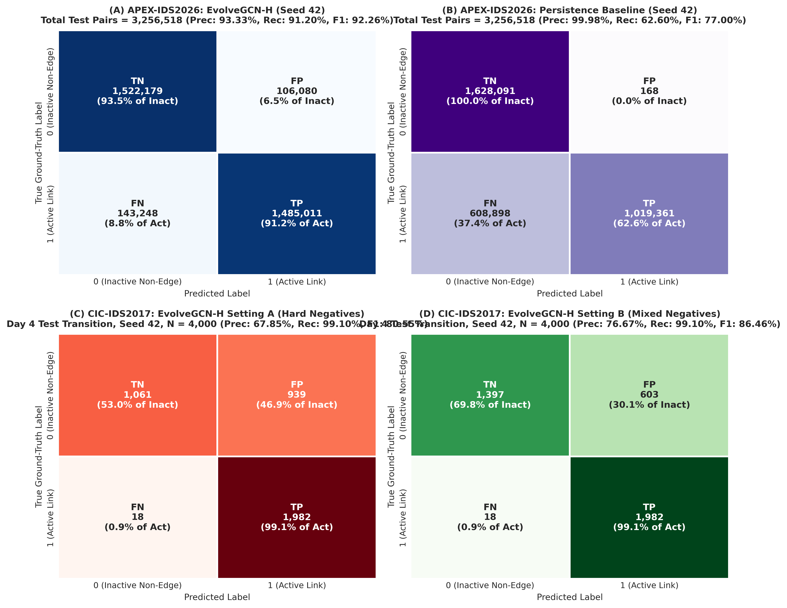  
*Figure 13: Empirical confusion matrix heatmaps showing raw candidate counts and row-normalized percentages across models and negative sampling regimes. (A) APEX-IDS2026: EvolveGCN-H on the test partition (Seed 42, N = 3,256,518 pairs; TN = 1,522,179 [93.5% of Inactive], FP = 106,080 [6.5%], FN = 143,248 [8.8% of Active], TP = 1,485,011 [91.2%]; Precision = 93.33%, Recall = 91.20%, F1 = 92.26%). (B) APEX-IDS2026: Persistence baseline (Seed 42, N = 3,256,518 pairs; TN = 1,628,091 [99.99%], FP = 168 [0.01%], FN = 608,898 [37.4%], TP = 1,019,361 [62.6%]; Precision = 99.98%, Recall = 62.60%, F1 = 77.00%). (C) CIC-IDS2017: EvolveGCN-H under Setting A (Hard Historical Negatives, Day 4 transition, Seed 42, N = 4,000 pairs; TN = 1,061 [53.1%], FP = 939 [46.9%], FN = 18 [0.9%], TP = 1,982 [99.1%]; Precision = 67.85%, Recall = 99.10%, F1 = 80.55%). (D) CIC-IDS2017: EvolveGCN-H under Setting B (Mixed Random Negatives, Day 4 transition, Seed 42, N = 4,000 pairs; TN = 1,397 [69.9%], FP = 603 [30.1%], FN = 18 [0.9%], TP = 1,982 [99.1%]; Precision = 76.67%, Recall = 99.10%, F1 = 86.46%).*

---

## 7. Limitations and Threats to Validity

1. **Restricted Empirical Scope:** Our findings are strictly restricted to the evaluated telemetry streams (APEX-IDS2026, 44 days; CIC-IDS2017, 5 days) under the specified snapshot and candidate generation protocol. They do not constitute universal claims regarding all enterprise networks or intrusion detection datasets.
2. **Single-Transition Test Split on CIC-IDS2017:** Due to the 5-day duration of CIC-IDS2017 and the requirement for chronological train/validation/test ordering (Monday–Wednesday train, Thursday validation), the test split contains exactly **one daily transition** (Thursday to Friday). While sub-daily windowing partially mitigates this, CIC test evaluations inherently represent a single calendar day.
3. **Statistical Interpretation of Seeds:** The five random seeds (`[42, 100, 123, 456, 999]`) measure algorithmic initialization and candidate-sampling variability within the fixed temporal partitions. They do **not** represent independent temporal test periods, nor do they establish general temporal invariance across unobserved timeframes or seasonal network shifts. Following our candidate generation overhaul with stable lexicographical sorting of candidate pools and known nodes, candidate generation is 100% deterministic and bit-for-bit reproducible across separate Python processes regardless of `PYTHONHASHSEED`, as verified in unit regression tests.
4. **Base-Rate Fallacy in Deployment:** In operational networks, the ratio of active edges to potential non-edges is on the order of $1 : 10^5$ or greater. The balanced 1:1 candidate ratio evaluated here serves as a controlled comparative benchmark; operational precision in an uncurated deployment would be substantially lower due to extreme class imbalance, and balanced ROC-AUC/Average Precision values cannot be directly extrapolated to operational detection efficacy.
5. **Absence of Flow Semantic Attributes in GNN:** EvolveGCN-H was evaluated strictly on structural degree features to isolate topological learning. Integrating rich flow attributes (bytes, packets, flags, duration) into dynamic GNN edges remains necessary to determine whether neural models can surpass heuristic baselines.
6. **Unverifiable Operational Claims in Dataset Provenance:** While cryptographic checksums (MD5 against the Zenodo deposit record; SHA-256) confirm local archive file integrity, and the 69.1M flow count and anonymized graph topology are directly computed from the extracted files, operational infrastructure claims (such as live MikroTik router collection on ISP infrastructure, 13,638 unique attacker IPs across 60 countries, and a claimed 0% false-positive rate for honeypot ground truth) represent third-party *dataset assertions* that cannot be independently audited because raw PCAP traces and cleartext IPs are unavailable.
7. **Model Architecture Scope and Omission of Continuous-Time Models:** We evaluate an adapted EvolveGCN-H variant (global mean pooling with vectorized GRU parameter evolution) rather than canonical top-$k$ node-selection EvolveGCN-H. Conclusions regarding recurrent parameter evolution apply to this specific implementation. Continuous-time dynamic models (TGN, DyRep) and attention-based snapshot architectures (DySAT) were omitted because they require microsecond-level continuous edge event queues or fine-grained temporal self-attention over node histories. In our telemetry setting, network telemetry is aggregated into discrete chronological snapshots (24h, 12h, 6h, 1h) to scale to tens of millions of network flows across enterprise networks. Implementing TGN or DySAT on graphs with $>400,000$ nodes requires streaming edge queues and GPU memory that exceed typical batch graph constraints; we document this omission clearly as an architectural boundary of discrete snapshot benchmarks.
8. **Candidate-Universe Asymmetry and Stratification Limitations:** In the controlled 5-seed benchmark, positive candidate sets are evaluated jointly as $E_{t+1}^{\text{eval}}$ ($1:1$ balanced with negative candidate sets). Stratified analysis reveals that on APEX, recurring edges comprise $62.60\%$ of positive edges in the uncapped test partition, while new edges between active known nodes comprise $37.40\%$. Furthermore, Setting B samples negatives strictly from $V_t \times V_t$ while positive candidates include a $\approx 18-21\%$ minority of re-emerging historical nodes ($V_{<t} \setminus V_t$); negative candidates in Setting B therefore never contain dormant historical endpoints. Metrics across Setting A and Setting B reflect different candidate universes and are not directly comparable. We state this candidate-universe asymmetry as an explicit methodological limitation rather than claiming unseen-node or candidate-universe concerns are fully resolved.

---

## 8. Conclusion and Future Work

Temporal link prediction in network security is highly sensitive to negative candidate sampling regimes and underlying topological churn. Random negative sampling flatters persistence and memorization baselines by masking link-extinction failures, whereas hard historical negatives reveal substantial precision degradation. Across continuous enterprise telemetry (APEX-IDS2026) and laboratory cyber-range data (CIC-IDS2017), sliding-window memory (EdgeBank-tw) and Common Neighbors heuristics provide robust, competitive baselines that outperform both unbounded memory and adapted recurrent GCN variants. On CIC-IDS2017, five seeds measure algorithmic and candidate-sampling variability across a single chronological test transition rather than independent temporal periods; conclusions should not be extrapolated to unobserved timeframes or long-term operational networks without multi-month continuous evaluation. Rigorous dynamic network security evaluations must enforce chronological candidate stratification, report hard historical negatives, evaluate threshold-free continuous metrics alongside thresholded decisions, and transparently acknowledge optimization boundaries.

Future work will expand this benchmark in three directions: (1) evaluating continuous-time dynamic graph neural networks (e.g., TGN, DyGFormer) that update node representations on individual edge arrivals; (2) incorporating semantic flow-level attributes (packet lengths, inter-arrival times, protocol flags) alongside structural degree encodings to assess multi-modal dynamic representation learning; and (3) formalizing matched-universe negative sampling protocols that evaluate candidate non-edges drawn across identical historical universes to further isolate the impact of dormant host re-emergence.

---

## CRediT Authorship Contribution Statement

* **Dheeraj Kovoord:** Conceptualization, Methodology, Software, Formal Analysis, Investigation, Data Curation, Writing – Original Draft, Writing – Review & Editing, Visualization, Project Administration.
* **Research Team:** Supervision, Validation, Resources.

---

## Declaration of Competing Interest

The authors declare that they have no known competing financial interests or personal relationships that could have appeared to influence the work reported in this paper.

---

## Acknowledgements & Funding

The authors express their gratitude to the Canadian Institute for Cybersecurity for public distribution of the CIC-IDS2017 cyber-range dataset, and to the creators of the APEX-IDS2026 benchmark dataset deposited on Zenodo. This research did not receive any specific grant from funding agencies in the public, commercial, or not-for-profit sectors.

---

## Data and Code Availability Statement

* **CIC-IDS2017:** Publicly distributed by the Canadian Institute for Cybersecurity, University of New Brunswick (https://www.unb.ca/cic/datasets/ids-2017.html).
* **APEX-IDS2026:** Distributed on Zenodo under the Creative Commons Attribution 4.0 International (CC BY 4.0) license (DOI: `10.5281/zenodo.22013914`, Archive MD5: `115ed72bb8759d3ce90fe17c52a0ee98`, Parquet SHA-256: `7e7855964ddc8061804fa48acfd6c2a3e1891462466654f9294cdab58744730c`, URL: https://doi.org/10.5281/zenodo.22013914).
* **Code and Benchmark Metrics:** Complete evaluation scripts, baseline implementations, candidate samplers, and structured CSV/JSON results are available within the project repository under an open-source license.

---

## References

1. Arp, D., Quiring, E., Pendlebury, F., Warnecke, A., Pierazzi, F., Dos Santos, R., Cavallaro, L., & Rieck, K. (2022). Dos and don'ts of machine learning in computer security. *Proceedings of the 31st USENIX Security Symposium*, 3971–3988.
2. Axelsson, S. (2000). The base-rate fallacy and the difficulty of intrusion detection. *ACM Transactions on Information and System Security (TISSEC)*, 3(3), 186–205.
3. Bilot, T., El Madhoun, N., Al Agha, K., & Zouaoui, A. (2023). Graph neural networks for intrusion detection: A survey. *IEEE Access*, 11, 49114–49139.
4. Engelen, G., Rimmer, V., & Joosen, W. (2021). Troubleshooting an unintended cheat: Bandwidth and public IP features in the CIC-IDS-2017 dataset. In *Proceedings of the 2021 ACM Workshop on Cyber Threat Intelligence and Information Sharing (CyTII '21)* (pp. 13–20). ACM. DOI: 10.1145/3474718.3474730.
5. Ferrag, M. A., Friha, O., Hamouda, D., Maglaras, L., & Janicke, H. (2022). Edge-IIoTset: A new comprehensive realistic cyber security dataset of IoT and IIoT applications for centralized and federated learning. *IEEE Access*, 10, 40281–40306.
6. Holme, P., & Saramäki, J. (2012). Temporal networks. *Physics Reports*, 519(3), 97–125.
7. Huang, S., Poursafaei, F., Danovitch, J., Fey, M., Hu, W., Rossi, E., Leskovec, J., Bronstein, M., Rabusseau, G., & Rabbany, R. (2023). Temporal graph benchmark for machine learning on temporal graphs. *Advances in Neural Information Processing Systems (NeurIPS)*, 36, 15615–15642.
8. Liben-Nowell, D., & Kleinberg, J. (2007). The link-prediction problem for social networks. *Journal of the American Society for Information Science and Technology*, 58(7), 1019–1031.
9. Pareja, A., Domeniconi, G., Chen, J., Teng, Z., Pawar, T., Perugini, D., & Kuleshov, V. (2020). EvolveGCN: Evolving graph convolutional networks for dynamic graphs. *Proceedings of the AAAI Conference on Artificial Intelligence*, 34(04), 5363–5370.
10. Poursafaei, F., Huang, S., Pelrine, K., & Rabbany, R. (2022). Towards better evaluation for dynamic link prediction. *Advances in Neural Information Processing Systems (NeurIPS)*, 35, 32965–32977.
11. Rossi, E., Chamberlain, B., Frasca, F., Eynard, D., Monti, F., & Bronstein, M. (2020). Temporal graph networks for deep learning on dynamic graphs. *ICML Workshop on Graph Representation Learning*.
12. Sankar, A., Wu, Y., Gou, L., Zhang, W., & Yang, H. (2020). DySAT: Deep neural representation learning on dynamic graphs via self-attention networks. *Proceedings of the 13th International Conference on Web Search and Data Mining (WSDM)*, 519–527.
13. Sharafaldin, I., Lashkari, A. H., & Ghorbani, A. A. (2018). Toward generating a new intrusion detection dataset and intrusion traffic characterization. *Proceedings of the 4th International Conference on Information Systems Security and Privacy (ICISSP)*, 108–116.
14. Sommer, R., & Paxson, V. (2010). Outside the closed world: On using machine learning for network intrusion detection. *IEEE Symposium on Security and Privacy (S&P)*, 305–316.
15. Wang, Y., Chang, Y.-Y., Liu, Y., Leskovec, J., & Li, P. (2023). DyGLib: A unified library for dynamic graph learning. *Advances in Neural Information Processing Systems (NeurIPS)*, 36.
16. Xu, D., Ruan, C., Korpeoglu, E., Kumar, S., & Achan, K. (2020). Inductive representation learning on temporal graphs. *International Conference on Learning Representations (ICLR)*.
17. APEX Research Team. (2026). *APEX-IDS2026: High-Confidence Enterprise Network Security Telemetry Dataset* [Data set]. Zenodo. https://doi.org/10.5281/zenodo.22013914
